# DEVELOPMENT_MAP.md - Debian Installeur Unifié

Delta SCM du 2026-11-12 : [add-zsh-sshhvp1](openspec/changes/archive/2026-11-12-add-zsh-sshhvp1/proposal.md), archivé, code non attribué ; alias Zsh pour le lancement distant X11, 1 353 tests dont 2 ignorés et tests Zsh isolés réussis ; statistiques individuelles vérifiées, delta global incompatible, livraison CICD en fin de session. Attribution ultérieure par ACL.

Delta SCM du 2026-11-11 : [add-projects-coding-rules](openspec/changes/archive/2026-11-11-add-projects-coding-rules/proposal.md), **code non attribué**, archivé ; synchronisation des règles, création vérifiée ; 54 tests ciblés et 1 353 tests globaux dont 2 ignorés ; OpenSpec strict réussi. [Statistiques](openspec/changes/archive/2026-11-11-add-projects-coding-rules/STATISTICS.md) produites, delta global refusé pour registre incompatible ; livraison en attente. Attribution ultérieure par ACL.

Delta SCM du 2026-11-11 : [declare-apt-sources-and-software-recipes](openspec/changes/archive/2026-11-11-declare-apt-sources-and-software-recipes/proposal.md), **code non attribué**, archivé ; 23 recettes GLOBAL, 18 variables de dépôts détectées, non-free/firmware indépendants ; 1 347 tests dont 2 ignorés, intégration Debian et OpenSpec strict réussis. Recettes DevOps, Docker et IA préservées ; prérequis bureau autorisé. [Statistiques individuelles](openspec/changes/archive/2026-11-11-declare-apt-sources-and-software-recipes/STATISTICS.md) vérifiées ; delta global refusé pour registre incompatible. Livraison par CICD en fin de session. Attribution ultérieure par ACL.

Delta SCM du 2026-11-11 : [converge-software-desired-state](openspec/changes/archive/2026-11-11-converge-software-desired-state/proposal.md), **code non attribué**, archivé ; migration des états désirés et convergence APT, Flatpak et GitHub raccordées ; 1 326 tests globaux dont 2 ignorés, contrôles ciblés et OpenSpec strict réussis. [Statistiques individuelles](openspec/changes/archive/2026-11-11-converge-software-desired-state/STATISTICS.md) produites ; delta global refusé car registre incompatible, livraison en cours. Attribution ultérieure par ACL.

Delta SCM du 2026-11-10 : [debian-recipe-file-mode](openspec/changes/archive/2026-11-10-debian-recipe-file-mode/proposal.md), **code non attribué**, archivé ; mode explicite des fichiers dans les recettes Debian et mode 0755 pour le point d’entrée DIU ; 15 tests ciblés, 1 238 tests globaux dont 2 ignorés et OpenSpec strict réussis ; livraison à vérifier. Attribution ultérieure par ACL.


Delta SCM du 2026-11-10 : [fix-replay-provider-credentials](openspec/changes/archive/2026-11-10-fix-replay-provider-credentials/proposal.md), **code non attribué**, archivé ; identifiants GitHub et GitLab préparés dans le projet source avant rejeu ; 1 236 tests exécutés dont 2 ignorés, contrôles ciblés et OpenSpec strict réussis ; état de livraison à constater sur les forges. Attribution ultérieure par ACL.

Delta SCM du 2026-11-10 : [enforce-provider-version-authority](openspec/changes/archive/2026-11-10-enforce-provider-version-authority/proposal.md), **code non attribué**, archivé ; contrôle des tags et alignement protégé des références pour pushes directs et CI/CD ; 1 236 tests exécutés dont 2 ignorés, contrôles ciblés et OpenSpec strict réussis ; état de livraison à constater sur les forges. Attribution ultérieure par ACL.

Delta SCM du 2026-11-10 : [fix-direct-provider-push](openspec/changes/archive/2026-11-10-fix-direct-provider-push/proposal.md), **code non attribué**, archivé ; pushes directs Forgejo, GitLab et GitHub alignés sur la réconciliation CI/CD, aides mises à jour ; 1 226 tests exécutés dont 2 ignorés, contrôles Bash, ShellCheck et OpenSpec strict réussis ; CI/CD 1.3.4 publiée sur Forgejo et GitHub, GitLab non configuré. Attribution ultérieure par ACL.

Correctif du 9 novembre 2026 : `preserve-cab-hmac-key-permissions`, ACTIF,
code non attribué ; normalisation des répertoires en 2770, fichiers ordinaires et HMAC en 0770 ; 3/3 tâches historiques validées ;
livraison indépendante à déterminer. [Tâches](openspec/changes/preserve-cab-hmac-key-permissions/tasks.md).


Delta SCM du 2026-11-06 : [remove-softwares-apt-update](openspec/changes/archive/2026-11-06-remove-softwares-apt-update/proposal.md), **code non attribué**, archivé ; OpenSpec strict, contrôles ciblés et 1 220 tests globaux dont 2 ignorés réussis ; sans CI/CD ; attribution ultérieure par ACL.

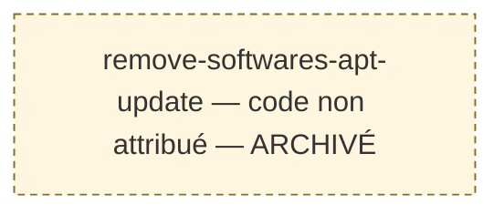
Delta SCM du 2026-11-06 : [isolate-created-project-directories](openspec/changes/archive/2026-11-06-isolate-created-project-directories/proposal.md), code non attribué, archivé ; création de trois dossiers locaux vides et initialisation OpenSpec sans copie du modèle, 61 tests ciblés réussis ; livraison non effectuée. Attribution ultérieure par ACL.

Delta SCM du 2026-11-06 : [adjust-project-sync-local-resources](openspec/changes/archive/2026-11-06-adjust-project-sync-local-resources/proposal.md), code non attribué, archivé ; synchronisation limitée à `AGENTS.md` et `.gitignore`, création locale de `.cab-tests`, 52 tests ciblés réussis ; livraison non effectuée. Attribution ultérieure par ACL.


Delta SCM du 2026-11-06 : [nest-system-engine-update](openspec/changes/archive/2026-11-06-nest-system-engine-update/proposal.md), code non attribué ; archivé, 1 212 tests globaux dont 2 ignorés avec Python DevOps, tests ciblés, Bash et OpenSpec strict réussis ; sans CI/CD ; attribution ultérieure par ACL.

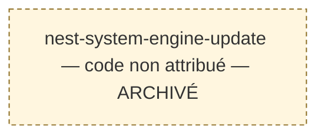
Delta SCM du 2026-11-05 : [decouple-softwares-from-universal-update](openspec/changes/archive/2026-11-05-decouple-softwares-from-universal-update/proposal.md), archivé, **code non attribué** ; OpenSpec strict validé, 132 tests ciblés et 1 211 tests globaux dont 2 ignorés ; livraison à vérifier ; attribution ultérieure par ACL.

Delta SCM du 2026-11-05 : [split-system-update-engines](openspec/changes/archive/2026-11-05-split-system-update-engines/proposal.md), archivé, **code non attribué** ; 1209 tests dont 2 ignorés, OpenSpec strict et contrôles Bash réussis ; CI/CD non effectuée ; attribution ultérieure par ACL.


Delta SCM du 2026-11-05 : [fix-system-update-codex-duplicate](openspec/changes/archive/2026-11-05-fix-system-update-codex-duplicate/proposal.md), archivé, **code non attribué** ; spécification stricte validée ; 1 207 tests exécutés dont 2 ignorés, 73 tests ciblés et contrôles Bash réussis ; sans CI/CD ; attribution ultérieure par ACL.

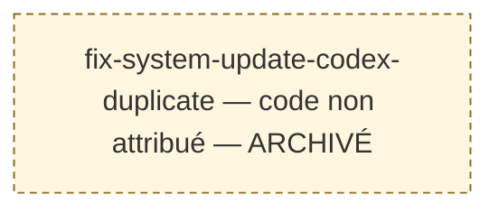

Delta SCM du 2026-11-05 : [fix-system-update-apt-cli-warning](openspec/changes/archive/2026-11-05-fix-system-update-apt-cli-warning/proposal.md), archivé, **code non attribué** ; spécification stricte validée ; 1 205 tests exécutés dont 2 ignorés, 39 tests ciblés et contrôles Bash réussis ; sans CI/CD ; attribution ultérieure par ACL.

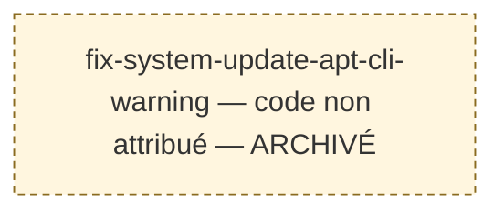

Delta SCM du 2026-11-05 : [improve-system-update-report](openspec/changes/archive/2026-11-05-improve-system-update-report/proposal.md), archivé, **code non attribué** ; spécification stricte validée ; 1 200 tests exécutés dont 2 ignorés, contrôles ciblés et Bash réussis ; sans CI/CD ; attribution ultérieure par ACL.

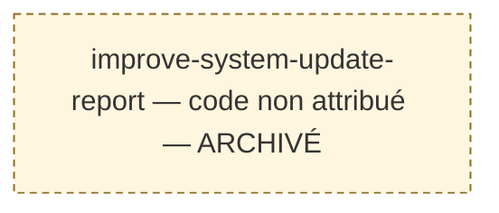

Delta SCM du 2026-11-05 : [refresh-codex-cli-state](openspec/changes/archive/2026-11-05-refresh-codex-cli-state/proposal.md), archivé, **code non attribué** ; recalcul de l’état Codex CLI, 1 190 tests dont 2 ignorés ; attribution ultérieure par ACL.

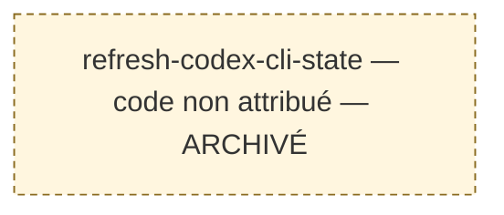

Delta SCM du 2026-11-05 : [manage-software-engines](openspec/changes/archive/2026-11-05-manage-software-engines/proposal.md), archivé, **code non attribué** ; 1 190 tests exécutés dont 2 ignorés, sans échec ; pas de CI/CD ; attribution ultérieure par ACL.

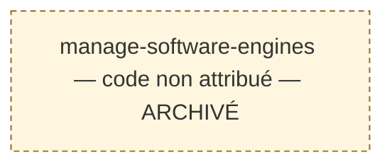

Delta SCM du 2026-11-05 : [display-software-inventory](openspec/changes/archive/2026-11-05-display-software-inventory/proposal.md), archivé, **code non attribué** ; 1 179 tests exécutés, dont 2 ignorés, sans échec ; attribution ultérieure par ACL.

Delta SCM du 2026-11-05 : [remove-software-deb-engine](openspec/changes/archive/2026-11-05-remove-software-deb-engine/proposal.md), archivé, **code non attribué** ; suppression du moteur logiciel deb, 1 177 tests dont 2 ignorés ; attribution ultérieure par ACL.

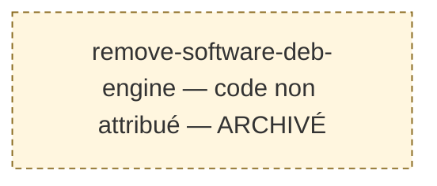

Delta SCM du 2026-11-05 : [converge-diu-to-diu](openspec/changes/converge-diu-to-diu/proposal.md), actif, **code non attribué** ; spécification validée en mode strict ; code, alias, aide et documentation convergés ; 1 177 tests globaux exécutés, 2 ignorés, aucun échec ; sources stables, OpenSpec ciblé strict réussi ; 47 échecs stricts préexistants inchangés. Archivage éligible, sans CI/CD. Attribution ultérieure par ACL.

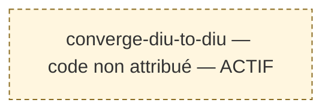

Delta SCM du 2026-11-04 : [report-and-display-system-hosts](openspec/changes/archive/2026-11-04-report-and-display-system-hosts/proposal.md), archivé, **code non attribué** ; contrôles ciblés validés ; attribution ultérieure par ACL.

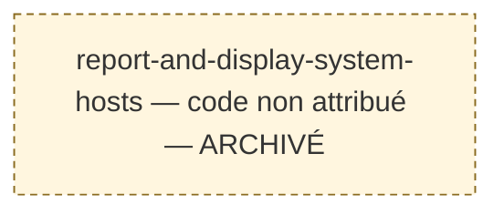

Delta SCM du 2026-11-04 : [move-hosts-commands-to-system](openspec/changes/archive/2026-11-04-move-hosts-commands-to-system/proposal.md), archivé, **code non attribué** ; contrôles ciblés validés ; attribution ultérieure par ACL.

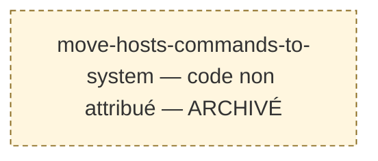

Delta SCM du 2026-11-04 : [rename-projects-network-hosts-commands](openspec/changes/archive/2026-11-04-rename-projects-network-hosts-commands/proposal.md), archivé, **code non attribué** ; contrôles ciblés validés ; attribution ultérieure par ACL.

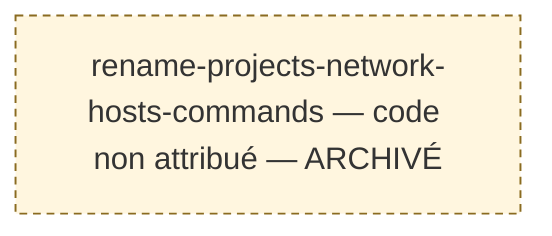

Delta SCM du 2026-11-04 : [manage-production-hosts-entries](openspec/changes/archive/2026-11-04-manage-production-hosts-entries/proposal.md), archivé, **code non attribué** ; contrôles ciblés validés ; attribution ultérieure par ACL.

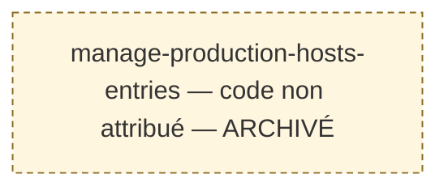

Delta SCM du 2026-11-04 : [reconcile-cicd-git-publication](openspec/changes/reconcile-cicd-git-publication/proposal.md), code non attribué, actif ; réalisation testée sur fixtures, 1 182 tests globaux exécutés dont 2 ignorés, validation OpenSpec stricte réussie ; synchronisation, archivage et publication 1.2.2 en attente. Attribution ultérieure par ACL.

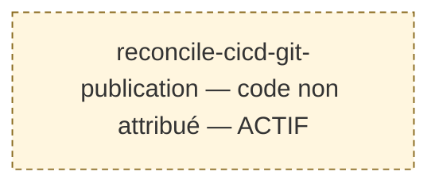

Delta SCM du 2026-11-04 : [handle-cicd-release-unavailability](openspec/changes/archive/2026-11-04-handle-cicd-release-unavailability/proposal.md), code non attribué, archivé ; validation globale : 1 171 tests exécutés, dont 2 ignorés ; OpenSpec strict réussi. Attribution ultérieure par ACL.

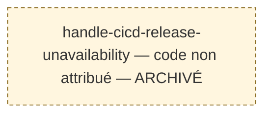

Delta SCM du 2026-11-04 : [ensure-diu-link-at-startup](openspec/changes/archive/2026-11-04-ensure-diu-link-at-startup/proposal.md), code non attribué, archivé le 2026-11-04 ; validation réussie : 1 165 tests dont 2 ignorés, ShellCheck et OpenSpec strict, dépend du contrat archivé [diu-command-links](openspec/changes/archive/2026-11-04-diu-command-links/proposal.md). Attribution ultérieure par ACL.

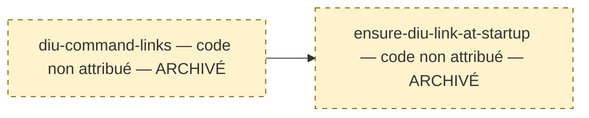

Delta SCM du 2026-11-04 : [configure-system-hosts-json](openspec/changes/archive/2026-11-04-configure-system-hosts-json/proposal.md), archivé, **code non attribué** ; contrôles ciblés validés ; attribution ultérieure par ACL.

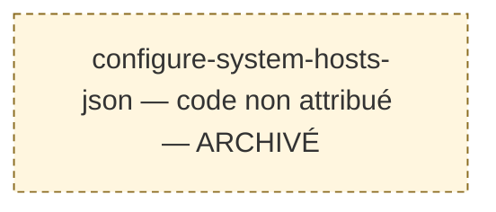

Delta SCM du 2026-11-04 : [manage-system-network-hosts](openspec/changes/archive/2026-11-04-manage-system-network-hosts/proposal.md), archivé, **code non attribué** ; contrôles ciblés validés ; attribution ultérieure par ACL.

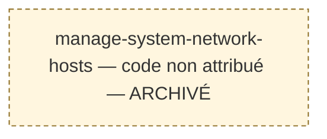

Delta SCM du 2026-11-04 : [diu-command-links](openspec/changes/archive/2026-11-04-diu-command-links/proposal.md), code non attribué, archivé le 2026-11-04 ; validation finale réussie : 1 164 tests dont 2 ignorés, ShellCheck réussi, voir [bilan](openspec/changes/archive/2026-11-04-diu-command-links/STATISTICS.md). Dépendance : [migrate-env-devops-projects-root](openspec/changes/archive/2026-11-04-migrate-env-devops-projects-root/tasks.md), validée et archivée le 2026-11-04. Attribution ultérieure par ACL.

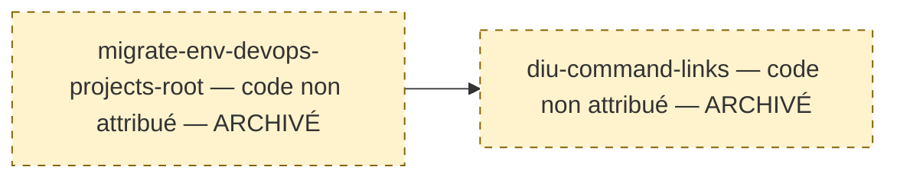

Delta SCM du 2026-11-04 : [stop-setting-technical-account-passwords](openspec/changes/archive/2026-11-04-stop-setting-technical-account-passwords/proposal.md), code non attribué, archivé ; 1 149 tests exécutés dont 2 ignorés, OpenSpec strict réussi. Publication différée. Attribution ultérieure par ACL.

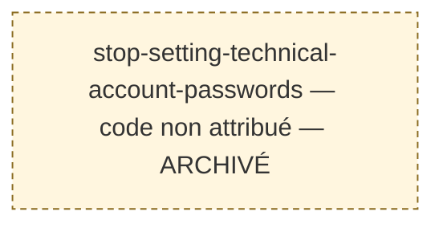

Delta SCM du 2026-11-03 : [migrate-env-devops-projects-root](openspec/changes/archive/2026-11-04-migrate-env-devops-projects-root/proposal.md), code non attribué, archivé le 2026-11-04 ; 1 164 tests dont 2 ignorés et ShellCheck réussis, voir [bilan](openspec/changes/archive/2026-11-04-migrate-env-devops-projects-root/STATISTICS.md). Attribution ultérieure par ACL.

```mermaid
flowchart TB
  classDef provisoire fill:#fff6df,stroke:#8a6b20,stroke-dasharray:4 3
  P_ENV_PROJECTS_ROOT["migrate-env-devops-projects-root — code non attribué — ARCHIVÉ"]
  class P_ENV_PROJECTS_ROOT provisoire
```

Delta SCM du 2026-11-03 : [restore-diu-forgejo-fallback](openspec/changes/archive/2026-11-03-restore-diu-forgejo-fallback/proposal.md), code non attribué, archivé ; 1 124 tests exécutés dont 2 ignorés, OpenSpec strict réussi ; comptages historiques inchangés. Attribution ultérieure par ACL.

```mermaid
flowchart TB
  classDef provisoire fill:#fff6df,stroke:#8a6b20,stroke-dasharray:4 3
  P_DIU_FORGEJO_FALLBACK["restore-diu-forgejo-fallback — code non attribué — ARCHIVÉ"]
  class P_DIU_FORGEJO_FALLBACK provisoire
```

Delta SCM du 2026-11-06 : [concise-diu-update-output](openspec/changes/archive/2026-11-06-concise-diu-update-output/proposal.md), code non attribué, archivé ; sortie DIU, résultat réseau et aides, validation stricte et 1 216 tests dont 2 ignorés. Attribution ultérieure par ACL.

```mermaid
flowchart TB
  classDef provisoire fill:#fff6df,stroke:#8a6b20,stroke-dasharray:4 3
  P_DIU_OUTPUT["concise-diu-update-output — code non attribué — ARCHIVÉ"]
  class P_DIU_OUTPUT provisoire
```

Delta SCM du 2026-11-03 : [github-only-diu-update](openspec/changes/archive/2026-11-03-github-only-diu-update/proposal.md), code non attribué, archivé ; 1 121 tests exécutés dont 2 ignorés, validation OpenSpec stricte réussie. Les comptages historiques excluent ce delta. Attribution ultérieure par ACL.

```mermaid
flowchart TB
  classDef provisoire fill:#fff6df,stroke:#8a6b20,stroke-dasharray:4 3
  P_DIU_GH_ONLY["github-only-diu-update — code non attribué — ARCHIVÉ"]
  class P_DIU_GH_ONLY provisoire
```

Delta SCM du 2026-11-03 : [harmonize-project-configuration](openspec/changes/archive/2026-11-03-harmonize-project-configuration/proposal.md), code non attribué, archivé ; 62 tests ciblés réussis. Attribution ultérieure par ACL. Les comptages historiques excluent ce delta.

```mermaid
graph LR
  P_PROJECT_CONFIG["harmonize-project-configuration — code non attribué — ARCHIVÉ"]
```

Plan initial validé : `ACL-DIU-20261028-R1`. Relevé et attribution : **2026-10-28**.

Maintenance documentaire validée : `ACSM-DIU-20261028-R1`, volets P1 à P4, voie éditoriale directe, le **2026-10-28**. Les codes et états de cycle de vie sont conservés.

## 1. Périmètre et fraîcheur

Delta SCM du 2026-11-03 : [remove-orchestrated-coding-from-sync](openspec/changes/archive/2026-11-03-remove-orchestrated-coding-from-sync/proposal.md), code non attribué, archivé ; 50 tests ciblés réussis. Attribution ultérieure par ACL.

Delta SCM du 2026-11-03 : [harmonize-cicd-publication-messages](openspec/changes/archive/2026-11-03-harmonize-cicd-publication-messages/proposal.md), code non attribué, archivé ; 1 119 tests exécutés dont 2 ignorés. Les comptages historiques excluent ce delta ; aucun commit ni changement de version.

Delta SCM du 2026-11-03 : [replay-cicd-existing-version](openspec/changes/archive/2026-11-03-replay-cicd-existing-version/proposal.md), code non attribué, archivé ; 1 119 tests exécutés dont 2 ignorés. Rejeu isolé et préservation des références ; les comptages historiques excluent ce delta.

Delta SCM du 2026-11-03 : [add-devops-project-env-guidance](openspec/changes/archive/2026-11-03-add-devops-project-env-guidance/proposal.md), code non attribué, archivé ; 3 tâches validées, 1 105 tests exécutés dont 2 ignorés, validations OpenSpec strictes réussies. Les comptages historiques excluent ce delta ; attribution ultérieure par ACL.

```mermaid
flowchart TB
  classDef provisoire fill:#fff6df,stroke:#8a6b20,stroke-dasharray:4 3
  P_ENV_GUIDANCE["add-devops-project-env-guidance — code non attribué — ARCHIVÉ"]
  class P_ENV_GUIDANCE provisoire
```

Delta SCM du 2026-11-03 : [cicd-version-idempotence-cleanup](openspec/changes/archive/2026-11-03-cicd-version-idempotence-cleanup/proposal.md), code non attribué, archivé ; 1 103 tests exécutés dont 2 ignorés. Sauvegarde et nettoyage des tags et releases 2026 effectués ; les comptages historiques excluent ce delta.

Delta du 2026-11-03 : [authenticate-diu-github-updates](openspec/changes/archive/2026-11-03-authenticate-diu-github-updates/proposal.md), code non attribué, archivé le 2026-11-03 ; six tâches validées et 1 088 tests exécutés dont 2 ignorés. Les comptages historiques excluent ce delta.

```mermaid
flowchart TB
  classDef provisoire fill:#fff6df,stroke:#8a6b20,stroke-dasharray:4 3
  P_DIU_GH_AUTH["authenticate-diu-github-updates — code non attribué — ARCHIVÉ"]
  class P_DIU_GH_AUTH provisoire
```

Delta SCM du 2026-11-03 : [fix-diu-http-compression](openspec/changes/archive/2026-11-03-fix-diu-http-compression/proposal.md), code non attribué, archivé le 2026-11-03. Cinq tâches validées ; 1 083 tests exécutés dont 2 ignorés ; preuves dans [tasks.md](openspec/changes/archive/2026-11-03-fix-diu-http-compression/tasks.md). Les comptages historiques excluent ce delta.

```mermaid
flowchart TB
  classDef provisoire fill:#fff6df,stroke:#8a6b20,stroke-dasharray:4 3
  P_DIU_HTTP["fix-diu-http-compression — code non attribué — ARCHIVÉ"]
  class P_DIU_HTTP provisoire
```

Delta SCM du 2026-11-03 : [diu-package-update](openspec/changes/archive/2026-11-03-diu-package-update/proposal.md), code non attribué, archivé le 2026-11-03. Contrat OpenSpec et six tâches validés ; 1 080 tests globaux exécutés, dont 2 ignorés. Voir [tâches](openspec/changes/archive/2026-11-03-diu-package-update/tasks.md). Les comptages historiques excluent ce delta.

```mermaid
flowchart TB
  classDef provisoire fill:#fff6df,stroke:#8a6b20,stroke-dasharray:4 3
  P_DIU_UPDATE["diu-package-update — code non attribué — ARCHIVÉ"]
  class P_DIU_UPDATE provisoire
```

Delta SCM-GITHUB-DEBIAN-20261102-R1 : [add-github-debian-release](openspec/changes/archive/2026-11-02-add-github-debian-release/proposal.md),
ensemble ART, code non attribué. Contrat et publisher validés le 2026-11-02 ; 4/4 tâches
validées, 1 074 tests globaux et 175 tests ciblés réussis, archivé le 2026-11-02, quatre canons synchronisés dans [tasks.md](openspec/changes/archive/2026-11-02-add-github-debian-release/tasks.md).
Les comptages historiques excluent ce delta.

```mermaid
flowchart TB
  classDef provisoire fill:#fff6df,stroke:#8a6b20,stroke-dasharray:4 3
  P_GH_DEB["add-github-debian-release — code non attribué — ARCHIVÉ"]
  class P_GH_DEB provisoire
```

Delta SCM-CICD-DEBIAN-20261102-R1 : [add-debian-build-to-projects-cicd](openspec/changes/archive/2026-11-02-add-debian-build-to-projects-cicd/proposal.md),
ensemble ART, code non attribué. Contrat strict validé le 2026-11-02 ;
4/4 tâches validées : 1 049 tests globaux et 165 tests ciblés réussis ;
archivé le 2026-11-02, trois canons synchronisés, preuves dans [tasks.md](openspec/changes/archive/2026-11-02-add-debian-build-to-projects-cicd/tasks.md).
Les comptages historiques excluent ce delta.

```mermaid
flowchart TB
  classDef provisoire fill:#fff6df,stroke:#8a6b20,stroke-dasharray:4 3
  P_CICD_DEB["add-debian-build-to-projects-cicd — code non attribué — ARCHIVÉ"]
  class P_CICD_DEB provisoire
```

Delta SCM-PROJECT-VERSION-20261102-R1 : [prioritize-project-version](openspec/changes/archive/2026-11-02-prioritize-project-version/proposal.md),
ensemble ART/GIT, code non attribué. Contrat validé en strict le 2026-11-02 ;
4/4 tâches validées : 1 034 tests globaux et 74 tests finaux version/aide réussis ;
archivé le 2026-11-02, canons synchronisés, preuves dans [tasks.md](openspec/changes/archive/2026-11-02-prioritize-project-version/tasks.md).
Les comptages historiques excluent ce delta.

```mermaid
flowchart TB
  classDef provisoire fill:#fff6df,stroke:#8a6b20,stroke-dasharray:4 3
  P_VERSION["prioritize-project-version — code non attribué — ARCHIVÉ"]
  class P_VERSION provisoire
```

Delta SCM du 2026-11-02 : [add-projects-debian-build](openspec/changes/archive/2026-11-02-add-projects-debian-build/proposal.md),
ensemble ART, code non attribué. Change archivé le 2026-11-02, spécifications synchronisées : 1 018 tests globaux et 12 tests finaux réussis ;
4/4 tâches prouvées dans [tasks.md](openspec/changes/archive/2026-11-02-add-projects-debian-build/tasks.md).
Les comptages du relevé historique ci-dessous excluent ce delta.

```mermaid
flowchart TB
  classDef provisoire fill:#fff6df,stroke:#8a6b20,stroke-dasharray:4 3
  P_DEB_BUILD["add-projects-debian-build — code non attribué — ARCHIVÉ"]
  class P_DEB_BUILD provisoire
```

Couverture : **135 changes, 11 actifs et 124 archivés** : 125 lots codés répartis en neuf familles, trois changes actifs provisoires et sept changes archivés sans code. Les 125 codes sont attestés dans les titres des propositions et dans le [registre](openspec/BATCH_CODES.md). Le squelette initial, limité au titre conservé, est complété sous validation explicite des trois volets du plan.

Sources : [règles](AGENTS.md), [projet](PROJECT.md), [technique](TECHNICAL.md), [construction](BUILD.md), [environnement](DEVOPS.md), [configuration OpenSpec](openspec/config.yaml), propositions, deltas, tâches et preuves liées ci-dessous. Sources de vérité et preuves applicables prévalent sur cette synthèse.

**Faits vérifiés le 2026-10-28** : inventaire inchangé depuis le rapport préalable (125 dossiers et 696 artefacts Markdown/YAML), absence de liens symboliques dans les changes, titres attribués et comptages documentaires. Aucun BLOCKER.md ou BLOCKERS.md dans le périmètre ; cette absence ne prouve pas l’absence de dépendance.

**Faits documentés** : cases cochées et résultats historiques des sessions précédentes. **Non vérifié** : livraison, activation, services distants et qualification actuelle des comportements produit. ACL ne rejoue aucun test produit, build ou publication et ne réalise aucun accès réseau.

Bash, ShellCheck, Python DevOps, OpenSpec et les fichiers de tests ciblés sont présents. Cette disponibilité ne démontre pas la réussite des tests. Les contrôles documentaires ACL et OpenSpec sont distingués des preuves produit.

## 2. Vue d’ensemble

**A → B signifie que A dépend de B.** Les regroupements expriment une responsabilité documentée et ne créent aucune dépendance. La vue générale renvoie aux neuf vues détaillées couvrant tous les lots.

```mermaid
flowchart TB
  F_ARC["ARC — Architecture et qualité transverse — 3 lots : vue détaillée ARC"]
  F_CLI["CLI — Interface de commande — 5 lots : vue détaillée CLI"]
  F_SYS["SYS — Système Debian — 16 lots : vue détaillée SYS"]
  F_SW["SW — Gestion des logiciels — 12 lots : vue détaillée SW"]
  F_ENV["ENV — Environnements DevOps — 10 lots : vue détaillée ENV"]
  F_DEV["DEV — Documentation DevOps — 20 lots : vue détaillée DEV"]
  F_PRJ["PRJ — Gestion des projets — 17 lots : vue détaillée PRJ"]
  F_GIT["GIT — 31 lots codés et un change sans code : vues GIT et provisoires"]
  F_ART["ART — 11 lots codés et deux changes sans code : vues ART et provisoires"]
```

| Vue | Responsabilité | Codes | Justification |
|---|---|---|---|
| [ARC](#vue-arc) | Architecture, extraction transverse et qualité du monolithe | ARC01 à ARC03 (3) | [PROJECT.md](PROJECT.md) et propositions/capacités du registre |
| [CLI](#vue-cli) | Aide, commandes d’information et alias publics | CLI01 à CLI05 (5) | [TECHNICAL.md](TECHNICAL.md) et propositions/capacités du registre |
| [SYS](#vue-sys) | Debian, dépôts, prérequis, pilotes et configuration système | SYS01 à SYS16 (16) | [PROJECT.md](PROJECT.md) et propositions/capacités du registre |
| [SW](#vue-sw) | Moteurs et recettes de gestion des logiciels | SW01 à SW12 (12) | [PROJECT.md](PROJECT.md) et propositions/capacités du registre |
| [ENV](#vue-env) | Préparation des environnements, outils et variables DevOps | ENV01 à ENV10 (10) | [TECHNICAL.md](TECHNICAL.md) et propositions/capacités du registre |
| [DEV](#vue-dev) | Génération et inventaires du document DEVOPS.md | DEV01 à DEV20 (20) | [TECHNICAL.md](TECHNICAL.md) et propositions/capacités du registre |
| [PRJ](#vue-prj) | Configuration, création, copie, synchronisation et modèles des projets | PRJ01 à PRJ17 (17) | [PROJECT.md](PROJECT.md) et propositions/capacités du registre |
| [GIT](#vue-git) | Dépôts locaux, fournisseurs, authentification, push et clonage distant | GIT01 à GIT31 (31) | [TECHNICAL.md](TECHNICAL.md) et propositions/capacités du registre |
| [ART](#vue-art) | Construction, registres, releases et orchestration des artefacts | ART01 à ART11 (11) | [BUILD.md](BUILD.md) et propositions/capacités du registre |

## 3. Vues détaillées

Les libellés abrégés servent à la lecture ; le registre conserve titres et identifiants exacts. Les nœuds de contrats ne sont ni des lots supplémentaires ni des réservations. Les six relations directes sont détaillées au registre des dépendances.

<a id="vue-arc"></a>

### ARC — Architecture et qualité transverse

```mermaid
flowchart TB
  classDef actif fill:#e9f2ff,stroke:#245a9b
  classDef archive fill:#f2f2f2,stroke:#666
  classDef contrat fill:#fff6df,stroke:#8a6b20,stroke-dasharray:4 3
  ARC01["ARC01 — Extraire les fonctions de journalisation vers lib/logging.sh — ARCHIVÉ"]
  ARC02["ARC02 — Correction des diagnostics ShellCheck du point d’entrée — ARCHIVÉ"]
  ARC03["ARC03 — Architecture modulaire — ACTIF"]
  class ARC01,ARC02 archive
  class ARC03 actif
```

<a id="vue-cli"></a>

### CLI — Interface de commande

```mermaid
flowchart TB
  classDef actif fill:#e9f2ff,stroke:#245a9b
  classDef archive fill:#f2f2f2,stroke:#666
  classDef contrat fill:#fff6df,stroke:#8a6b20,stroke-dasharray:4 3
  CLI01["CLI01 — Aide contextuelle des commandes diu — ARCHIVÉ"]
  CLI02["CLI02 — Unification de l’aide contextuelle — ARCHIVÉ"]
  CLI03["CLI03 — Informations des modules — ARCHIVÉ"]
  CLI04["CLI04 — add system drivers infos — ARCHIVÉ"]
  CLI05["CLI05 — Corriger le chemin de l&#x27;alias ci — ARCHIVÉ"]
  class CLI01,CLI02,CLI03,CLI04,CLI05 archive
```

<a id="vue-sys"></a>

### SYS — Système Debian

```mermaid
flowchart TB
  classDef actif fill:#e9f2ff,stroke:#245a9b
  classDef archive fill:#f2f2f2,stroke:#666
  classDef contrat fill:#fff6df,stroke:#8a6b20,stroke-dasharray:4 3
  SYS01["SYS01 — Ajout de pytest aux prérequis système — ARCHIVÉ"]
  SYS02["SYS02 — Moteur des dépôts Debian officiels — ARCHIVÉ"]
  SYS03["SYS03 — Identification de la release Debian — ARCHIVÉ"]
  SYS04["SYS04 — Nettoyage de la variable Debian historique — ARCHIVÉ"]
  SYS05["SYS05 — Correction du nom du paquet Debian pytest — ARCHIVÉ"]
  SYS06["SYS06 — Réappliquer les composants Debian avant une mise à jour glo… — ARCHIVÉ"]
  SYS07["SYS07 — Installation des prérequis système — ARCHIVÉ"]
  SYS08["SYS08 — Clarifier les contextes de mise à jour — ARCHIVÉ"]
  SYS09["SYS09 — Ajouter libsecret-tools aux prérequis système — ARCHIVÉ"]
  SYS10["SYS10 — Moteur Flatpak du système — ARCHIVÉ"]
  SYS11["SYS11 — Détection de l’environnement Debian — ARCHIVÉ"]
  SYS12["SYS12 — Détection statique de DisplayLink — ARCHIVÉ"]
  SYS13["SYS13 — Gestion du fuseau horaire système — ARCHIVÉ"]
  SYS14["SYS14 — Convergence des prérequis système par environnement — ARCHIVÉ"]
  SYS15["SYS15 — manage system drivers displaylink — ARCHIVÉ"]
  SYS16["SYS16 — Moteur des dépôts Debian non officiels — ARCHIVÉ"]
  class SYS01,SYS02,SYS03,SYS04,SYS05,SYS06,SYS07,SYS08,SYS09,SYS10,SYS11,SYS12,SYS13,SYS14,SYS15,SYS16 archive
```

<a id="vue-sw"></a>

### SW — Gestion des logiciels

```mermaid
flowchart TB
  classDef actif fill:#e9f2ff,stroke:#245a9b
  classDef archive fill:#f2f2f2,stroke:#666
  classDef contrat fill:#fff6df,stroke:#8a6b20,stroke-dasharray:4 3
  SW01["SW01 — Gestion des logiciels et mise à jour universelle — ARCHIVÉ"]
  SW02["SW02 — moteur APT du module softwares — ARCHIVÉ"]
  SW03["SW03 — Mise à jour groupée des paquets Debian — ARCHIVÉ"]
  SW04["SW04 — Désactivation de la variable HOME de Codex CLI — ARCHIVÉ"]
  SW05["SW05 — Persistance de l’état APT ChatGPT — ARCHIVÉ"]
  SW06["SW06 — Persistance de l’état et mise à jour de Codex CLI absent — ARCHIVÉ"]
  SW07["SW07 — installation de ChatGPT Desktop par APT — ARCHIVÉ"]
  SW08["SW08 — moteur d&#x27;installation des logiciels depuis GitHub — ARCHIVÉ"]
  SW09["SW09 — mise à jour globale du module softwares — ARCHIVÉ"]
  SW10["SW10 — installer Codex CLI depuis GitHub — ARCHIVÉ"]
  SW11["SW11 — Retrait de la personnalisation ChatGPT — ARCHIVÉ"]
  SW12["SW12 — Gestion des applications Flatpak — ARCHIVÉ"]
  class SW01,SW02,SW03,SW04,SW05,SW06,SW07,SW08,SW09,SW10,SW11,SW12 archive
```

<a id="vue-env"></a>

### ENV — Environnements DevOps

```mermaid
flowchart TB
  classDef actif fill:#e9f2ff,stroke:#245a9b
  classDef archive fill:#f2f2f2,stroke:#666
  classDef contrat fill:#fff6df,stroke:#8a6b20,stroke-dasharray:4 3
  ENV01["ENV01 — allow human sudo devops — ARCHIVÉ"]
  ENV02["ENV02 — allow human sudo docker — ARCHIVÉ"]
  ENV03["ENV03 — Diagnostic des téléchargements Node.js — ARCHIVÉ"]
  ENV04["ENV04 — Préparation OpenSpec du domicile DevOps — ARCHIVÉ"]
  ENV05["ENV05 — Installation de Psycopg dans Python DevOps — ARCHIVÉ"]
  ENV06["ENV06 — report sudoers human accounts — ARCHIVÉ"]
  ENV07["ENV07 — Désactivation de la gestion Psycopg par le DIU — ARCHIVÉ"]
  ENV08["ENV08 — Indicateurs des environnements de test DevOps — ARCHIVÉ"]
  ENV09["ENV09 — Alignement du format des indicateurs de test — ARCHIVÉ"]
  ENV10["ENV10 — upgrade devops opencode v2 — ARCHIVÉ"]
  class ENV01,ENV02,ENV03,ENV04,ENV05,ENV06,ENV07,ENV08,ENV09,ENV10 archive
```

<a id="vue-dev"></a>

### DEV — Documentation DevOps

```mermaid
flowchart TB
  classDef actif fill:#e9f2ff,stroke:#245a9b
  classDef archive fill:#f2f2f2,stroke:#666
  classDef contrat fill:#fff6df,stroke:#8a6b20,stroke-dasharray:4 3
  DEV01["DEV01 — Génération du document DevOps — ARCHIVÉ"]
  DEV02["DEV02 — Génération DevOps groupée — ARCHIVÉ"]
  DEV03["DEV03 — Généralisation du document DevOps aux projets — ARCHIVÉ"]
  DEV04["DEV04 — Réorganisation de la syntaxe template devops — ARCHIVÉ"]
  DEV05["DEV05 — Inventaire des navigateurs pour les tests headless — ARCHIVÉ"]
  DEV06["DEV06 — Provenance et horodatage du relevé DevOps — ARCHIVÉ"]
  DEV07["DEV07 — Inventaire des dépendances JavaScript — ARCHIVÉ"]
  DEV08["DEV08 — Priorité aux environnements Python des projets — ARCHIVÉ"]
  DEV09["DEV09 — Référencement des prompts dans DEVOPS.md — ARCHIVÉ"]
  DEV10["DEV10 — Références Docker pour les tests dans DEVOPS.md — ARCHIVÉ"]
  DEV11["DEV11 — Ajouter le nom d&#x27;hôte au document DevOps — ARCHIVÉ"]
  DEV12["DEV12 — Section Matériel et inventaire TPM du document DevOps — ARCHIVÉ"]
  DEV13["DEV13 — Préparer les droits d&#x27;exécution des outils DevOps — ARCHIVÉ"]
  DEV14["DEV14 — Autorisation des tests dans les conteneurs documentés — ARCHIVÉ"]
  DEV15["DEV15 — Rubriques conditionnelles des conteneurs de test — ARCHIVÉ"]
  DEV16["DEV16 — Détection déclarative de Cython — ARCHIVÉ"]
  DEV17["DEV17 — Détection déclarative de Nuitka — ARCHIVÉ"]
  DEV18["DEV18 — Ajouter OpenSSH et SSHPASS au document DevOps — ARCHIVÉ"]
  DEV19["DEV19 — Préciser l’accès SSH au conteneur LXC et conserver ses dépe… — ARCHIVÉ"]
  DEV20["DEV20 — Indication de la source du mot de passe API OpenCode — ARCHIVÉ"]
  class DEV01,DEV02,DEV03,DEV04,DEV05,DEV06,DEV07,DEV08,DEV09,DEV10,DEV11,DEV12,DEV13,DEV14,DEV15,DEV16,DEV17,DEV18,DEV19,DEV20 archive
  DEV17 -->|socle inventaire Cython| DEV16
```

<a id="vue-prj"></a>

### PRJ — Gestion des projets

```mermaid
flowchart TB
  classDef actif fill:#e9f2ff,stroke:#245a9b
  classDef archive fill:#f2f2f2,stroke:#666
  classDef contrat fill:#fff6df,stroke:#8a6b20,stroke-dasharray:4 3
  PRJ01["PRJ01 — séparation de la configuration des projets et de Git local — ARCHIVÉ"]
  PRJ02["PRJ02 — Clonage local des projets — ARCHIVÉ"]
  PRJ03["PRJ03 — Synchronisation unitaire des projets — ARCHIVÉ"]
  PRJ04["PRJ04 — Synchronisation groupée des projets — ARCHIVÉ"]
  PRJ05["PRJ05 — Mise à jour générale des projets — ARCHIVÉ"]
  PRJ06["PRJ06 — Application de tous les modèles à tous les projets — ARCHIVÉ"]
  PRJ07["PRJ07 — Préparation OpenSpec des projets — ARCHIVÉ"]
  PRJ08["PRJ08 — Préparation OpenSpec groupée — ARCHIVÉ"]
  PRJ09["PRJ09 — Préservation de DEVOPS.md pendant la synchronisation — ARCHIVÉ"]
  PRJ10["PRJ10 — Réorganisation de la syntaxe template openspec — ARCHIVÉ"]
  PRJ11["PRJ11 — Initialisation OpenCode conditionnée au dossier du projet — ARCHIVÉ"]
  PRJ12["PRJ12 — Déclaration du mode de codage des projets — ARCHIVÉ"]
  PRJ13["PRJ13 — Copie conditionnelle du protocole de codage piloté — ARCHIVÉ"]
  PRJ14["PRJ14 — Exclusion du dépôt Git lors de la copie du modèle — ARCHIVÉ"]
  PRJ15["PRJ15 — Limitation de la synchronisation aux ressources autorisées — ARCHIVÉ"]
  PRJ16["PRJ16 — Copie initiale de DEVELOPMENT_MAP.md pendant la synchronisa… — ARCHIVÉ"]
  PRJ17["PRJ17 — Base du projet cloné — ACTIF"]
  class PRJ01,PRJ02,PRJ03,PRJ04,PRJ05,PRJ06,PRJ07,PRJ08,PRJ09,PRJ10,PRJ11,PRJ12,PRJ13,PRJ14,PRJ15,PRJ16 archive
  class PRJ17 actif
  PRJ04 -->|contrat de synchronisation unitaire| PRJ03
```

<a id="vue-git"></a>

### GIT — Dépôts et fournisseurs Git

```mermaid
flowchart TB
  classDef actif fill:#e9f2ff,stroke:#245a9b
  classDef archive fill:#f2f2f2,stroke:#666
  classDef contrat fill:#fff6df,stroke:#8a6b20,stroke-dasharray:4 3
  GIT01["GIT01 — Authentification Git HTTPS par jeton — ARCHIVÉ"]
  GIT02["GIT02 — création automatique du remote GitLab — ARCHIVÉ"]
  GIT03["GIT03 — commande de mise à jour GitLab — ARCHIVÉ"]
  GIT04["GIT04 — prise en charge des certificats GitLab autosignés — ARCHIVÉ"]
  GIT05["GIT05 — Retrait du parcours Git distant générique — ARCHIVÉ"]
  GIT06["GIT06 — publication des projets vers Forgejo — ARCHIVÉ"]
  GIT07["GIT07 — mise à jour de la configuration Forgejo — ARCHIVÉ"]
  GIT08["GIT08 — publication des projets vers GitHub — ARCHIVÉ"]
  GIT09["GIT09 — mise à jour de la configuration GitHub — ARCHIVÉ"]
  GIT10["GIT10 — publication des projets vers GitLab — ARCHIVÉ"]
  GIT11["GIT11 — configuration différentielle GitLab — ARCHIVÉ"]
  GIT12["GIT12 — Création contrôlée des dépôts GitHub — ARCHIVÉ"]
  GIT13["GIT13 — Publication Forgejo groupée — ARCHIVÉ"]
  GIT14["GIT14 — Initialisation Git dans le contexte projects git — ARCHIVÉ"]
  GIT15["GIT15 — Commit Git groupé des projets — ARCHIVÉ"]
  GIT16["GIT16 — Clonage des projets depuis GitHub — ARCHIVÉ"]
  GIT17["GIT17 — Clonage des projets depuis GitLab — ARCHIVÉ"]
  GIT18["GIT18 — refactoriser l&#x27;analyse Git des projets — ARCHIVÉ"]
  GIT19["GIT19 — refactor projects git commit — ARCHIVÉ"]
  GIT20["GIT20 — Statut Git dans le contexte projects git — ARCHIVÉ"]
  GIT21["GIT21 — create projects forgejo repository — ARCHIVÉ"]
  GIT22["GIT22 — protect github push with lease — ARCHIVÉ"]
  GIT23["GIT23 — Fournisseurs Git temporairement indisponibles — ARCHIVÉ"]
  GIT24["GIT24 — Correction des remotes Forgejo hérités — ARCHIVÉ"]
  GIT25["GIT25 — Gestion ciblée de safe.directory — ARCHIVÉ"]
  GIT26["GIT26 — allow git provider credentials 0660 — ARCHIVÉ"]
  GIT27["GIT27 — Clonage Forgejo — ACTIF"]
  GIT28["GIT28 — Initialisation avant commit — ACTIF"]
  GIT29["GIT29 — Identité Forgejo — ACTIF"]
  GIT30["GIT30 — Protection push Forgejo — ACTIF"]
  GIT31["GIT31 — Création par premier push — ACTIF"]
  class GIT01,GIT02,GIT03,GIT04,GIT05,GIT06,GIT07,GIT08,GIT09,GIT10,GIT11,GIT12,GIT13,GIT14,GIT15,GIT16,GIT17,GIT18,GIT19,GIT20,GIT21,GIT22,GIT23,GIT24,GIT25,GIT26 archive
  class GIT27,GIT28,GIT29,GIT30,GIT31 actif
  C_CREATION["Contrat interne — création de projet, configuration et authentification Forgejo"]
  C_INIT["Contrat interne — initialisation Git locale"]
  C_SERVER["Prérequis externe — création au premier push, NON VÉRIFIÉE"]
  GIT27 -->|réalisation et qualification| C_CREATION
  GIT28 -->|validation tâche 2.2| C_INIT
  GIT31 -->|qualification distante| C_SERVER
  class C_CREATION,C_INIT,C_SERVER contrat
```

<a id="vue-art"></a>

### ART — Construction et publication

```mermaid
flowchart TB
  classDef actif fill:#e9f2ff,stroke:#245a9b
  classDef archive fill:#f2f2f2,stroke:#666
  classDef contrat fill:#fff6df,stroke:#8a6b20,stroke-dasharray:4 3
  ART01["ART01 — Construction du paquet Debian du DIU — ARCHIVÉ"]
  ART02["ART02 — Publication des releases Forgejo — ARCHIVÉ"]
  ART03["ART03 — Rotation sûre des paquets Debian — ARCHIVÉ"]
  ART04["ART04 — publication GitLab des projets DIU — ARCHIVÉ"]
  ART05["ART05 — normaliser la construction Docker des projets — ARCHIVÉ"]
  ART06["ART06 — publication Forgejo unifiée des projets — ARCHIVÉ"]
  ART07["ART07 — Orchestration CI/CD des projets — ARCHIVÉ"]
  ART08["ART08 — Résumé des opérations CI/CD — ARCHIVÉ"]
  ART09["ART09 — Correction de la casse des références GHCR — ARCHIVÉ"]
  ART10["ART10 — Arguments Docker publics par projet — ARCHIVÉ"]
  ART11["ART11 — Registre GitLab — ACTIF"]
  class ART01,ART02,ART03,ART04,ART05,ART06,ART07,ART08,ART09,ART10 archive
  class ART11 actif
  C_REGISTRY["Contrat et service — configuration GitLab, registre explicite et release"]
  ART11 -->|qualification du registre| C_REGISTRY
  class C_REGISTRY contrat
```

<a id="vue-provisoires"></a>

### Changes actifs provisoires — code non attribué

Les regroupements GIT/ART expriment la responsabilité des propositions. Ils n’attribuent
aucun code ; aucun code ni lien de dépendance n’est inféré pour les changes
provisoires. Voir leurs
entrées distinctes dans le registre ci-dessous.

```mermaid
flowchart TB
  classDef provisoire fill:#fff6df,stroke:#8a6b20,stroke-dasharray:4 3
  P_BOOT["reconcile-forgejo-credential-bootstrap — code non attribué — ACTIF"]
  P_PACK["reconcile-diu-deb-packaging-contract — code non attribué — ACTIF"]
  P_LINK["fix-gitlab-release-asset-link-validation — code non attribué — ACTIF"]
  class P_BOOT,P_PACK,P_LINK provisoire
```

## 4. Registre des lots et changes

Les ratios comptent uniquement les lignes de cases du tasks.md lié. Ils ne prouvent pas la validation de chaque case ni le pourcentage de réalisation fonctionnelle. Les contrôles ACL portent sur les annotations. Les preuves produit restent historiques. **Livraison et activation : NON VÉRIFIÉES** pour toutes les entrées, faute de contrôle actuel dans ce mandat.

### Changes actifs

| Code | Identifiant et dossier | Titre | Cases cochées | Réalisabilité | Acquis et conditions de réexamen | Sources |
|---|---|---|---:|---|---|---|
| ARC03 | [define-modular-architecture](openspec/changes/define-modular-architecture/) | Proposal: Définir l'architecture cible modulaire du DIU | 2/4 | PARTIELLEMENT RÉALISABLE | Analyse documentaire possible ; validation développeur de l’architecture toujours ouverte. Le préambule a été déplacé dans la proposition ; validation OpenSpec standard et stricte réussie le 2026-10-28. | [proposal.md](openspec/changes/define-modular-architecture/proposal.md), [tasks.md](openspec/changes/define-modular-architecture/tasks.md), [design.md](openspec/changes/define-modular-architecture/design.md) |
| ART11 | [configure-gitlab-container-registry](openspec/changes/configure-gitlab-container-registry/) | Configuration explicite du registre de conteneurs GitLab | 8/8 | À VÉRIFIER | Réconciliation et validations ciblées du 2026-10-16 documentées ; qualification d’un registre réel et archivage distincts. | [proposal.md](openspec/changes/configure-gitlab-container-registry/proposal.md), [tasks.md](openspec/changes/configure-gitlab-container-registry/tasks.md), [design.md](openspec/changes/configure-gitlab-container-registry/design.md) |
| GIT27 | [add-projects-forgejo-clone](openspec/changes/add-projects-forgejo-clone/) | Clonage des projets depuis Forgejo | 0/6 | PARTIELLEMENT RÉALISABLE | Développement et tests isolés envisageables ; qualification Forgejo réelle à vérifier. Primitives présentes, flux spécifique à réaliser. | [proposal.md](openspec/changes/add-projects-forgejo-clone/proposal.md), [tasks.md](openspec/changes/add-projects-forgejo-clone/tasks.md), [design.md](openspec/changes/add-projects-forgejo-clone/design.md) |
| GIT28 | [ensure-projects-git-commit-init](openspec/changes/ensure-projects-git-commit-init/) | Initialisation Git avant le commit des projets | 3/4 | RÉALISABLE | Pour la validation locale de la tâche 2.2 : Bash, ShellCheck, Python DevOps, OpenSpec et tests ciblés présents. Réussite des tests produit à établir dans une session autorisée. | [proposal.md](openspec/changes/ensure-projects-git-commit-init/proposal.md), [tasks.md](openspec/changes/ensure-projects-git-commit-init/tasks.md), [design.md](openspec/changes/ensure-projects-git-commit-init/design.md) |
| GIT29 | [fix-forgejo-repository-identity](openspec/changes/fix-forgejo-repository-identity/) | Proposal | 4/4 | À VÉRIFIER | Contrôler l’actualité des preuves et la cohérence avec les évolutions Forgejo suivantes avant clôture. | [proposal.md](openspec/changes/fix-forgejo-repository-identity/proposal.md), [tasks.md](openspec/changes/fix-forgejo-repository-identity/tasks.md), [design.md](openspec/changes/fix-forgejo-repository-identity/design.md) |
| GIT30 | [modify-projects-forgejo-push-force-with-lease](openspec/changes/modify-projects-forgejo-push-force-with-lease/) | Protection des publications Forgejo par force-with-lease | 7/7 | À VÉRIFIER | Deltas documentaires réconciliés et revalidés en standard et strict le 2026-10-28. Les cases cochées restent historiques ; fraîcheur des preuves produit et conditions de clôture à vérifier. | [proposal.md](openspec/changes/modify-projects-forgejo-push-force-with-lease/proposal.md), [tasks.md](openspec/changes/modify-projects-forgejo-push-force-with-lease/tasks.md), [design.md](openspec/changes/modify-projects-forgejo-push-force-with-lease/design.md) |
| GIT31 | [restore-forgejo-push-to-create](openspec/changes/restore-forgejo-push-to-create/) | Proposal | 4/4 | À VÉRIFIER | Premier push sans création API présent dans la source ; fonction serveur non vérifiée. Delta documentaire réconcilié avec les neuf scénarios courants et revalidé en standard et strict le 2026-10-28 ; qualification distante à établir. | [proposal.md](openspec/changes/restore-forgejo-push-to-create/proposal.md), [tasks.md](openspec/changes/restore-forgejo-push-to-create/tasks.md), [design.md](openspec/changes/restore-forgejo-push-to-create/design.md) |
| PRJ17 | [modify-projects-clone-pg-database](openspec/changes/modify-projects-clone-pg-database/) | Personnalisation de PG_DATABASE lors du clonage | 4/4 | À VÉRIFIER | Remplacement conditionnel de PG_DATABASE présent dans clone_project ; validation historique à examiner avant clôture. | [proposal.md](openspec/changes/modify-projects-clone-pg-database/proposal.md), [tasks.md](openspec/changes/modify-projects-clone-pg-database/tasks.md) |

### Changes archivés

ARCHIVÉ décrit le rangement constaté, sans démontrer disponibilité, livraison ou activation. Attributions rétrospectives du 2026-10-28 ; tâches et preuves historiques conservées.

| Code | Famille | Identifiant et dossier | Titre | État | Cases cochées | Limite documentaire | Sources |
|---|---|---|---|---|---:|---|---|
| ARC01 | ARC | [refactor-extract-logging](openspec/changes/archive/2026-08-11-refactor-extract-logging/) | Proposal: Extraire les fonctions de journalisation vers lib/logging.sh | ARCHIVÉ | 10/10 | Cases complètes ; qualification produit actuelle non rejouée | [proposal.md](openspec/changes/archive/2026-08-11-refactor-extract-logging/proposal.md), [tasks.md](openspec/changes/archive/2026-08-11-refactor-extract-logging/tasks.md), [design.md](openspec/changes/archive/2026-08-11-refactor-extract-logging/design.md) |
| ARC02 | ARC | [fix-root-shellcheck](openspec/changes/archive/2026-09-28-fix-root-shellcheck/) | Correction des diagnostics ShellCheck du point d’entrée | ARCHIVÉ | 5/5 | Cases complètes ; qualification produit actuelle non rejouée | [proposal.md](openspec/changes/archive/2026-09-28-fix-root-shellcheck/proposal.md), [tasks.md](openspec/changes/archive/2026-09-28-fix-root-shellcheck/tasks.md), [design.md](openspec/changes/archive/2026-09-28-fix-root-shellcheck/design.md) |
| ART01 | ART | [add-deb-packaging](openspec/changes/archive/2026-08-12-add-deb-packaging/) | Construction du paquet Debian du DIU | ARCHIVÉ | 34/34 | Cases complètes ; qualification produit actuelle non rejouée | [proposal.md](openspec/changes/archive/2026-08-12-add-deb-packaging/proposal.md), [tasks.md](openspec/changes/archive/2026-08-12-add-deb-packaging/tasks.md), [design.md](openspec/changes/archive/2026-08-12-add-deb-packaging/design.md) |
| ART02 | ART | [publish-forgejo-release](openspec/changes/archive/2026-08-12-publish-forgejo-release/) | Publication des releases Forgejo | ARCHIVÉ | 16/16 | Cases complètes ; qualification produit actuelle non rejouée | [proposal.md](openspec/changes/archive/2026-08-12-publish-forgejo-release/proposal.md), [tasks.md](openspec/changes/archive/2026-08-12-publish-forgejo-release/tasks.md), [design.md](openspec/changes/archive/2026-08-12-publish-forgejo-release/design.md) |
| ART03 | ART | [safe-package-rotation](openspec/changes/archive/2026-08-12-safe-package-rotation/) | Rotation sûre des paquets Debian | ARCHIVÉ | 15/15 | Cases complètes ; qualification produit actuelle non rejouée | [proposal.md](openspec/changes/archive/2026-08-12-safe-package-rotation/proposal.md), [tasks.md](openspec/changes/archive/2026-08-12-safe-package-rotation/tasks.md), [design.md](openspec/changes/archive/2026-08-12-safe-package-rotation/design.md) |
| ART04 | ART | [implement-projects-gitlab-release](openspec/changes/archive/2026-09-07-implement-projects-gitlab-release/) | Proposition: publication GitLab des projets DIU | ARCHIVÉ | 8/8 | Cases complètes ; qualification produit actuelle non rejouée | [proposal.md](openspec/changes/archive/2026-09-07-implement-projects-gitlab-release/proposal.md), [tasks.md](openspec/changes/archive/2026-09-07-implement-projects-gitlab-release/tasks.md), [design.md](openspec/changes/archive/2026-09-07-implement-projects-gitlab-release/design.md) |
| ART05 | ART | [modify-projects-docker-build](openspec/changes/archive/2026-09-07-modify-projects-docker-build/) | Proposition : normaliser la construction Docker des projets | ARCHIVÉ | 6/6 | Cases complètes ; qualification produit actuelle non rejouée | [proposal.md](openspec/changes/archive/2026-09-07-modify-projects-docker-build/proposal.md), [tasks.md](openspec/changes/archive/2026-09-07-modify-projects-docker-build/tasks.md), [design.md](openspec/changes/archive/2026-09-07-modify-projects-docker-build/design.md) |
| ART06 | ART | [modify-projects-gitpdi](openspec/changes/archive/2026-09-07-modify-projects-gitpdi/) | Proposition : publication Forgejo unifiée des projets | ARCHIVÉ | 8/8 | Cases complètes ; qualification produit actuelle non rejouée | [proposal.md](openspec/changes/archive/2026-09-07-modify-projects-gitpdi/proposal.md), [tasks.md](openspec/changes/archive/2026-09-07-modify-projects-gitpdi/tasks.md), [design.md](openspec/changes/archive/2026-09-07-modify-projects-gitpdi/design.md) |
| ART07 | ART | [add-projects-cicd](openspec/changes/archive/2026-09-23-add-projects-cicd/) | Orchestration CI/CD des projets | ARCHIVÉ | 7/7 | Cases complètes ; qualification produit actuelle non rejouée | [proposal.md](openspec/changes/archive/2026-09-23-add-projects-cicd/proposal.md), [tasks.md](openspec/changes/archive/2026-09-23-add-projects-cicd/tasks.md), [design.md](openspec/changes/archive/2026-09-23-add-projects-cicd/design.md) |
| ART08 | ART | [add-projects-cicd-summary](openspec/changes/archive/2026-09-23-add-projects-cicd-summary/) | Résumé des opérations CI/CD | ARCHIVÉ | 4/4 | Cases complètes ; qualification produit actuelle non rejouée | [proposal.md](openspec/changes/archive/2026-09-23-add-projects-cicd-summary/proposal.md), [tasks.md](openspec/changes/archive/2026-09-23-add-projects-cicd-summary/tasks.md), [design.md](openspec/changes/archive/2026-09-23-add-projects-cicd-summary/design.md) |
| ART09 | ART | [fix-github-release-image-case](openspec/changes/archive/2026-10-15-fix-github-release-image-case/) | Correction de la casse des références GHCR | ARCHIVÉ | 7/7 | Cases complètes ; qualification produit actuelle non rejouée | [proposal.md](openspec/changes/archive/2026-10-15-fix-github-release-image-case/proposal.md), [tasks.md](openspec/changes/archive/2026-10-15-fix-github-release-image-case/tasks.md), [design.md](openspec/changes/archive/2026-10-15-fix-github-release-image-case/design.md), [STATISTICS.md](openspec/changes/archive/2026-10-15-fix-github-release-image-case/STATISTICS.md) |
| ART10 | ART | [support-project-docker-build-args](openspec/changes/archive/2026-10-15-support-project-docker-build-args/) | Arguments Docker publics par projet | ARCHIVÉ | 8/8 | Cases complètes ; qualification produit actuelle non rejouée | [proposal.md](openspec/changes/archive/2026-10-15-support-project-docker-build-args/proposal.md), [tasks.md](openspec/changes/archive/2026-10-15-support-project-docker-build-args/tasks.md), [design.md](openspec/changes/archive/2026-10-15-support-project-docker-build-args/design.md), [review.md](openspec/changes/archive/2026-10-15-support-project-docker-build-args/review.md), [STATISTICS.md](openspec/changes/archive/2026-10-15-support-project-docker-build-args/STATISTICS.md) |
| CLI01 | CLI | [add-rid-contextual-help](openspec/changes/archive/2026-09-05-add-rid-contextual-help/) | Aide contextuelle des commandes diu | ARCHIVÉ | 4/4 | Cases complètes ; qualification produit actuelle non rejouée | [proposal.md](openspec/changes/archive/2026-09-05-add-rid-contextual-help/proposal.md), [tasks.md](openspec/changes/archive/2026-09-05-add-rid-contextual-help/tasks.md), [design.md](openspec/changes/archive/2026-09-05-add-rid-contextual-help/design.md) |
| CLI02 | CLI | [refactor-help-command](openspec/changes/archive/2026-09-12-refactor-help-command/) | Unification de l’aide contextuelle | ARCHIVÉ | 6/6 | Cases complètes ; qualification produit actuelle non rejouée | [proposal.md](openspec/changes/archive/2026-09-12-refactor-help-command/proposal.md), [tasks.md](openspec/changes/archive/2026-09-12-refactor-help-command/tasks.md), [design.md](openspec/changes/archive/2026-09-12-refactor-help-command/design.md) |
| CLI03 | CLI | [add-module-infos](openspec/changes/archive/2026-09-28-add-module-infos/) | Informations des modules | ARCHIVÉ | 5/5 | Cases complètes ; qualification produit actuelle non rejouée | [proposal.md](openspec/changes/archive/2026-09-28-add-module-infos/proposal.md), [tasks.md](openspec/changes/archive/2026-09-28-add-module-infos/tasks.md), [design.md](openspec/changes/archive/2026-09-28-add-module-infos/design.md) |
| CLI04 | CLI | [add-system-drivers-infos](openspec/changes/archive/2026-09-28-add-system-drivers-infos/) | Why | ARCHIVÉ | 4/4 | Cases complètes ; qualification produit actuelle non rejouée | [proposal.md](openspec/changes/archive/2026-09-28-add-system-drivers-infos/proposal.md), [tasks.md](openspec/changes/archive/2026-09-28-add-system-drivers-infos/tasks.md), [design.md](openspec/changes/archive/2026-09-28-add-system-drivers-infos/design.md) |
| CLI05 | CLI | [fix-ci-prompts-index](openspec/changes/archive/2026-10-19-fix-ci-prompts-index/) | Corriger le chemin de l'alias ci | ARCHIVÉ | 6/6 | Cases complètes ; qualification produit actuelle non rejouée | [proposal.md](openspec/changes/archive/2026-10-19-fix-ci-prompts-index/proposal.md), [tasks.md](openspec/changes/archive/2026-10-19-fix-ci-prompts-index/tasks.md), [design.md](openspec/changes/archive/2026-10-19-fix-ci-prompts-index/design.md), [STATISTICS.md](openspec/changes/archive/2026-10-19-fix-ci-prompts-index/STATISTICS.md) |
| DEV01 | DEV | [add-projects-template-devops](openspec/changes/archive/2026-10-02-add-projects-template-devops/) | Génération du document DevOps | ARCHIVÉ | 9/9 | Cases complètes ; qualification produit actuelle non rejouée | [proposal.md](openspec/changes/archive/2026-10-02-add-projects-template-devops/proposal.md), [tasks.md](openspec/changes/archive/2026-10-02-add-projects-template-devops/tasks.md), [design.md](openspec/changes/archive/2026-10-02-add-projects-template-devops/design.md) |
| DEV02 | DEV | [add-projects-template-devops-all](openspec/changes/archive/2026-10-02-add-projects-template-devops-all/) | Génération DevOps groupée | ARCHIVÉ | 6/6 | Cases complètes ; qualification produit actuelle non rejouée | [proposal.md](openspec/changes/archive/2026-10-02-add-projects-template-devops-all/proposal.md), [tasks.md](openspec/changes/archive/2026-10-02-add-projects-template-devops-all/tasks.md), [design.md](openspec/changes/archive/2026-10-02-add-projects-template-devops-all/design.md) |
| DEV03 | DEV | [generalize-projects-template-devops](openspec/changes/archive/2026-10-02-generalize-projects-template-devops/) | Généralisation du document DevOps aux projets | ARCHIVÉ | 8/8 | Cases complètes ; qualification produit actuelle non rejouée | [proposal.md](openspec/changes/archive/2026-10-02-generalize-projects-template-devops/proposal.md), [tasks.md](openspec/changes/archive/2026-10-02-generalize-projects-template-devops/tasks.md), [design.md](openspec/changes/archive/2026-10-02-generalize-projects-template-devops/design.md) |
| DEV04 | DEV | [reorder-projects-template-devops](openspec/changes/archive/2026-10-02-reorder-projects-template-devops/) | Réorganisation de la syntaxe template devops | ARCHIVÉ | 5/5 | Cases complètes ; qualification produit actuelle non rejouée | [proposal.md](openspec/changes/archive/2026-10-02-reorder-projects-template-devops/proposal.md), [tasks.md](openspec/changes/archive/2026-10-02-reorder-projects-template-devops/tasks.md), [design.md](openspec/changes/archive/2026-10-02-reorder-projects-template-devops/design.md) |
| DEV05 | DEV | [add-projects-template-devops-headless-browsers](openspec/changes/archive/2026-10-03-add-projects-template-devops-headless-browsers/) | Inventaire des navigateurs pour les tests headless | ARCHIVÉ | 12/12 | Cases complètes ; qualification produit actuelle non rejouée | [proposal.md](openspec/changes/archive/2026-10-03-add-projects-template-devops-headless-browsers/proposal.md), [tasks.md](openspec/changes/archive/2026-10-03-add-projects-template-devops-headless-browsers/tasks.md), [design.md](openspec/changes/archive/2026-10-03-add-projects-template-devops-headless-browsers/design.md) |
| DEV06 | DEV | [add-projects-devops-report-provenance](openspec/changes/archive/2026-10-09-add-projects-devops-report-provenance/) | Provenance et horodatage du relevé DevOps | ARCHIVÉ | 6/6 | Cases complètes ; qualification produit actuelle non rejouée | [proposal.md](openspec/changes/archive/2026-10-09-add-projects-devops-report-provenance/proposal.md), [tasks.md](openspec/changes/archive/2026-10-09-add-projects-devops-report-provenance/tasks.md), [design.md](openspec/changes/archive/2026-10-09-add-projects-devops-report-provenance/design.md), [STATISTICS.md](openspec/changes/archive/2026-10-09-add-projects-devops-report-provenance/STATISTICS.md) |
| DEV07 | DEV | [inventory-project-javascript-dependencies-in-devops](openspec/changes/archive/2026-10-09-inventory-project-javascript-dependencies-in-devops/) | Inventaire des dépendances JavaScript | ARCHIVÉ | 6/6 | Cases complètes ; qualification produit actuelle non rejouée | [proposal.md](openspec/changes/archive/2026-10-09-inventory-project-javascript-dependencies-in-devops/proposal.md), [tasks.md](openspec/changes/archive/2026-10-09-inventory-project-javascript-dependencies-in-devops/tasks.md), [design.md](openspec/changes/archive/2026-10-09-inventory-project-javascript-dependencies-in-devops/design.md), [STATISTICS.md](openspec/changes/archive/2026-10-09-inventory-project-javascript-dependencies-in-devops/STATISTICS.md) |
| DEV08 | DEV | [prefer-project-venvs-for-devops-dependencies](openspec/changes/archive/2026-10-09-prefer-project-venvs-for-devops-dependencies/) | Priorité aux environnements Python des projets | ARCHIVÉ | 6/6 | Cases complètes ; qualification produit actuelle non rejouée | [proposal.md](openspec/changes/archive/2026-10-09-prefer-project-venvs-for-devops-dependencies/proposal.md), [tasks.md](openspec/changes/archive/2026-10-09-prefer-project-venvs-for-devops-dependencies/tasks.md), [design.md](openspec/changes/archive/2026-10-09-prefer-project-venvs-for-devops-dependencies/design.md), [STATISTICS.md](openspec/changes/archive/2026-10-09-prefer-project-venvs-for-devops-dependencies/STATISTICS.md) |
| DEV09 | DEV | [add-devops-prompts-section](openspec/changes/archive/2026-10-19-add-devops-prompts-section/) | Référencement des prompts dans DEVOPS.md | ARCHIVÉ | 8/8 | Cases complètes ; qualification produit actuelle non rejouée | [proposal.md](openspec/changes/archive/2026-10-19-add-devops-prompts-section/proposal.md), [tasks.md](openspec/changes/archive/2026-10-19-add-devops-prompts-section/tasks.md), [design.md](openspec/changes/archive/2026-10-19-add-devops-prompts-section/design.md), [STATISTICS.md](openspec/changes/archive/2026-10-19-add-devops-prompts-section/STATISTICS.md) |
| DEV10 | DEV | [document-devops-docker-test-reference](openspec/changes/archive/2026-10-22-document-devops-docker-test-reference/) | Références Docker pour les tests dans DEVOPS.md | ARCHIVÉ | 2/2 | Cases complètes ; qualification produit actuelle non rejouée | [proposal.md](openspec/changes/archive/2026-10-22-document-devops-docker-test-reference/proposal.md), [tasks.md](openspec/changes/archive/2026-10-22-document-devops-docker-test-reference/tasks.md), [design.md](openspec/changes/archive/2026-10-22-document-devops-docker-test-reference/design.md), [review.md](openspec/changes/archive/2026-10-22-document-devops-docker-test-reference/review.md), [STATISTICS.md](openspec/changes/archive/2026-10-22-document-devops-docker-test-reference/STATISTICS.md) |
| DEV11 | DEV | [add-devops-development-hostname](openspec/changes/archive/2026-10-23-add-devops-development-hostname/) | Ajouter le nom d'hôte au document DevOps | ARCHIVÉ | 6/6 | Cases complètes ; qualification produit actuelle non rejouée | [proposal.md](openspec/changes/archive/2026-10-23-add-devops-development-hostname/proposal.md), [tasks.md](openspec/changes/archive/2026-10-23-add-devops-development-hostname/tasks.md), [design.md](openspec/changes/archive/2026-10-23-add-devops-development-hostname/design.md), [STATISTICS.md](openspec/changes/archive/2026-10-23-add-devops-development-hostname/STATISTICS.md) |
| DEV12 | DEV | [add-devops-hardware-tpm](openspec/changes/archive/2026-10-23-add-devops-hardware-tpm/) | Section Matériel et inventaire TPM du document DevOps | ARCHIVÉ | 7/7 | Cases complètes ; qualification produit actuelle non rejouée | [proposal.md](openspec/changes/archive/2026-10-23-add-devops-hardware-tpm/proposal.md), [tasks.md](openspec/changes/archive/2026-10-23-add-devops-hardware-tpm/tasks.md), [design.md](openspec/changes/archive/2026-10-23-add-devops-hardware-tpm/design.md), [STATISTICS.md](openspec/changes/archive/2026-10-23-add-devops-hardware-tpm/STATISTICS.md) |
| DEV13 | DEV | [ensure-devops-tool-executable-permissions](openspec/changes/archive/2026-10-23-ensure-devops-tool-executable-permissions/) | Préparer les droits d'exécution des outils DevOps | ARCHIVÉ | 6/6 | Cases complètes ; qualification produit actuelle non rejouée | [proposal.md](openspec/changes/archive/2026-10-23-ensure-devops-tool-executable-permissions/proposal.md), [tasks.md](openspec/changes/archive/2026-10-23-ensure-devops-tool-executable-permissions/tasks.md), [design.md](openspec/changes/archive/2026-10-23-ensure-devops-tool-executable-permissions/design.md), [STATISTICS.md](openspec/changes/archive/2026-10-23-ensure-devops-tool-executable-permissions/STATISTICS.md) |
| DEV14 | DEV | [add-devops-test-container-authorization](openspec/changes/archive/2026-10-24-add-devops-test-container-authorization/) | Autorisation des tests dans les conteneurs documentés | ARCHIVÉ | 7/7 | Cases complètes ; qualification produit actuelle non rejouée | [proposal.md](openspec/changes/archive/2026-10-24-add-devops-test-container-authorization/proposal.md), [tasks.md](openspec/changes/archive/2026-10-24-add-devops-test-container-authorization/tasks.md), [design.md](openspec/changes/archive/2026-10-24-add-devops-test-container-authorization/design.md), [STATISTICS.md](openspec/changes/archive/2026-10-24-add-devops-test-container-authorization/STATISTICS.md) |
| DEV15 | DEV | [condition-devops-test-container-sections](openspec/changes/archive/2026-10-24-condition-devops-test-container-sections/) | Rubriques conditionnelles des conteneurs de test | ARCHIVÉ | 7/7 | Cases complètes ; qualification produit actuelle non rejouée | [proposal.md](openspec/changes/archive/2026-10-24-condition-devops-test-container-sections/proposal.md), [tasks.md](openspec/changes/archive/2026-10-24-condition-devops-test-container-sections/tasks.md), [design.md](openspec/changes/archive/2026-10-24-condition-devops-test-container-sections/design.md), [STATISTICS.md](openspec/changes/archive/2026-10-24-condition-devops-test-container-sections/STATISTICS.md) |
| DEV16 | DEV | [add-devops-cython-detection](openspec/changes/archive/2026-10-26-add-devops-cython-detection/) | Détection déclarative de Cython | ARCHIVÉ | 6/6 | Cases complètes ; qualification produit actuelle non rejouée | [proposal.md](openspec/changes/archive/2026-10-26-add-devops-cython-detection/proposal.md), [tasks.md](openspec/changes/archive/2026-10-26-add-devops-cython-detection/tasks.md), [design.md](openspec/changes/archive/2026-10-26-add-devops-cython-detection/design.md), [STATISTICS.md](openspec/changes/archive/2026-10-26-add-devops-cython-detection/STATISTICS.md) |
| DEV17 | DEV | [add-devops-nuitka-detection](openspec/changes/archive/2026-10-26-add-devops-nuitka-detection/) | Détection déclarative de Nuitka | ARCHIVÉ | 6/6 | Cases complètes ; qualification produit actuelle non rejouée | [proposal.md](openspec/changes/archive/2026-10-26-add-devops-nuitka-detection/proposal.md), [tasks.md](openspec/changes/archive/2026-10-26-add-devops-nuitka-detection/tasks.md), [design.md](openspec/changes/archive/2026-10-26-add-devops-nuitka-detection/design.md), [STATISTICS.md](openspec/changes/archive/2026-10-26-add-devops-nuitka-detection/STATISTICS.md) |
| DEV18 | DEV | [add-devops-openssh-sshpass](openspec/changes/archive/2026-10-26-add-devops-openssh-sshpass/) | Ajouter OpenSSH et SSHPASS au document DevOps | ARCHIVÉ | 5/5 | Cases complètes ; qualification produit actuelle non rejouée | [proposal.md](openspec/changes/archive/2026-10-26-add-devops-openssh-sshpass/proposal.md), [tasks.md](openspec/changes/archive/2026-10-26-add-devops-openssh-sshpass/tasks.md), [design.md](openspec/changes/archive/2026-10-26-add-devops-openssh-sshpass/design.md), [STATISTICS.md](openspec/changes/archive/2026-10-26-add-devops-openssh-sshpass/STATISTICS.md) |
| DEV19 | DEV | [clarify-devops-lxc-ssh-access](openspec/changes/archive/2026-10-26-clarify-devops-lxc-ssh-access/) | Préciser l’accès SSH au conteneur LXC et conserver ses dépendances de test | ARCHIVÉ | 4/4 | Cases complètes ; qualification produit actuelle non rejouée | [proposal.md](openspec/changes/archive/2026-10-26-clarify-devops-lxc-ssh-access/proposal.md), [tasks.md](openspec/changes/archive/2026-10-26-clarify-devops-lxc-ssh-access/tasks.md), [design.md](openspec/changes/archive/2026-10-26-clarify-devops-lxc-ssh-access/design.md), [STATISTICS.md](openspec/changes/archive/2026-10-26-clarify-devops-lxc-ssh-access/STATISTICS.md) |
| DEV20 | DEV | [document-devops-opencode-password-source](openspec/changes/archive/2026-10-28-document-devops-opencode-password-source/) | Indication de la source du mot de passe API OpenCode | ARCHIVÉ | 4/4 | Cases complètes ; qualification produit actuelle non rejouée | [proposal.md](openspec/changes/archive/2026-10-28-document-devops-opencode-password-source/proposal.md), [tasks.md](openspec/changes/archive/2026-10-28-document-devops-opencode-password-source/tasks.md), [design.md](openspec/changes/archive/2026-10-28-document-devops-opencode-password-source/design.md), [STATISTICS.md](openspec/changes/archive/2026-10-28-document-devops-opencode-password-source/STATISTICS.md) |
| ENV01 | ENV | [allow-human-sudo-devops](openspec/changes/archive/2026-10-02-allow-human-sudo-devops/) | Why | ARCHIVÉ | 6/6 | Cases complètes ; qualification produit actuelle non rejouée | [proposal.md](openspec/changes/archive/2026-10-02-allow-human-sudo-devops/proposal.md), [tasks.md](openspec/changes/archive/2026-10-02-allow-human-sudo-devops/tasks.md), [design.md](openspec/changes/archive/2026-10-02-allow-human-sudo-devops/design.md) |
| ENV02 | ENV | [allow-human-sudo-docker](openspec/changes/archive/2026-10-02-allow-human-sudo-docker/) | Why | ARCHIVÉ | 7/7 | Cases complètes ; qualification produit actuelle non rejouée | [proposal.md](openspec/changes/archive/2026-10-02-allow-human-sudo-docker/proposal.md), [tasks.md](openspec/changes/archive/2026-10-02-allow-human-sudo-docker/tasks.md), [design.md](openspec/changes/archive/2026-10-02-allow-human-sudo-docker/design.md) |
| ENV03 | ENV | [clarify-devops-nodejs-download-errors](openspec/changes/archive/2026-10-02-clarify-devops-nodejs-download-errors/) | Diagnostic des téléchargements Node.js | ARCHIVÉ | 7/7 | Cases complètes ; qualification produit actuelle non rejouée | [proposal.md](openspec/changes/archive/2026-10-02-clarify-devops-nodejs-download-errors/proposal.md), [tasks.md](openspec/changes/archive/2026-10-02-clarify-devops-nodejs-download-errors/tasks.md), [design.md](openspec/changes/archive/2026-10-02-clarify-devops-nodejs-download-errors/design.md) |
| ENV04 | ENV | [configure-devops-home-openspec](openspec/changes/archive/2026-10-02-configure-devops-home-openspec/) | Préparation OpenSpec du domicile DevOps | ARCHIVÉ | 6/6 | Cases complètes ; qualification produit actuelle non rejouée | [proposal.md](openspec/changes/archive/2026-10-02-configure-devops-home-openspec/proposal.md), [tasks.md](openspec/changes/archive/2026-10-02-configure-devops-home-openspec/tasks.md), [design.md](openspec/changes/archive/2026-10-02-configure-devops-home-openspec/design.md) |
| ENV05 | ENV | [install-devops-psycopg](openspec/changes/archive/2026-10-02-install-devops-psycopg/) | Installation de Psycopg dans Python DevOps | ARCHIVÉ | 8/8 | Cases complètes ; qualification produit actuelle non rejouée | [proposal.md](openspec/changes/archive/2026-10-02-install-devops-psycopg/proposal.md), [tasks.md](openspec/changes/archive/2026-10-02-install-devops-psycopg/tasks.md), [design.md](openspec/changes/archive/2026-10-02-install-devops-psycopg/design.md) |
| ENV06 | ENV | [report-sudoers-human-accounts](openspec/changes/archive/2026-10-02-report-sudoers-human-accounts/) | Why | ARCHIVÉ | 7/7 | Cases complètes ; qualification produit actuelle non rejouée | [proposal.md](openspec/changes/archive/2026-10-02-report-sudoers-human-accounts/proposal.md), [tasks.md](openspec/changes/archive/2026-10-02-report-sudoers-human-accounts/tasks.md), [design.md](openspec/changes/archive/2026-10-02-report-sudoers-human-accounts/design.md) |
| ENV07 | ENV | [disable-diu-psycopg-management](openspec/changes/archive/2026-10-03-disable-diu-psycopg-management/) | Désactivation de la gestion Psycopg par le DIU | ARCHIVÉ | 10/10 | Cases complètes ; qualification produit actuelle non rejouée | [proposal.md](openspec/changes/archive/2026-10-03-disable-diu-psycopg-management/proposal.md), [tasks.md](openspec/changes/archive/2026-10-03-disable-diu-psycopg-management/tasks.md), [design.md](openspec/changes/archive/2026-10-03-disable-diu-psycopg-management/design.md) |
| ENV08 | ENV | [add-devops-tests-environment-flags](openspec/changes/archive/2026-10-24-add-devops-tests-environment-flags/) | Indicateurs des environnements de test DevOps | ARCHIVÉ | 8/8 | Cases complètes ; qualification produit actuelle non rejouée | [proposal.md](openspec/changes/archive/2026-10-24-add-devops-tests-environment-flags/proposal.md), [tasks.md](openspec/changes/archive/2026-10-24-add-devops-tests-environment-flags/tasks.md), [design.md](openspec/changes/archive/2026-10-24-add-devops-tests-environment-flags/design.md), [STATISTICS.md](openspec/changes/archive/2026-10-24-add-devops-tests-environment-flags/STATISTICS.md) |
| ENV09 | ENV | [align-devops-tests-environment-flags](openspec/changes/archive/2026-10-24-align-devops-tests-environment-flags/) | Alignement du format des indicateurs de test | ARCHIVÉ | 6/6 | Cases complètes ; qualification produit actuelle non rejouée | [proposal.md](openspec/changes/archive/2026-10-24-align-devops-tests-environment-flags/proposal.md), [tasks.md](openspec/changes/archive/2026-10-24-align-devops-tests-environment-flags/tasks.md), [design.md](openspec/changes/archive/2026-10-24-align-devops-tests-environment-flags/design.md), [STATISTICS.md](openspec/changes/archive/2026-10-24-align-devops-tests-environment-flags/STATISTICS.md) |
| ENV10 | ENV | [upgrade-devops-opencode-v2](openspec/changes/archive/2026-10-28-upgrade-devops-opencode-v2/) | Proposal | ARCHIVÉ | 5/5 | Cases complètes ; qualification produit actuelle non rejouée | [proposal.md](openspec/changes/archive/2026-10-28-upgrade-devops-opencode-v2/proposal.md), [tasks.md](openspec/changes/archive/2026-10-28-upgrade-devops-opencode-v2/tasks.md), [design.md](openspec/changes/archive/2026-10-28-upgrade-devops-opencode-v2/design.md), [STATISTICS.md](openspec/changes/archive/2026-10-28-upgrade-devops-opencode-v2/STATISTICS.md) |
| GIT01 | GIT | [git-https-token-auth](openspec/changes/archive/2026-08-12-git-https-token-auth/) | Authentification Git HTTPS par jeton | ARCHIVÉ | 42/50 | Cases historiques conservées ; archive close, aucune régularisation requise | [proposal.md](openspec/changes/archive/2026-08-12-git-https-token-auth/proposal.md), [tasks.md](openspec/changes/archive/2026-08-12-git-https-token-auth/tasks.md), [design.md](openspec/changes/archive/2026-08-12-git-https-token-auth/design.md) |
| GIT02 | GIT | [add-gitlab-remote-ensure](openspec/changes/archive/2026-09-07-add-gitlab-remote-ensure/) | Proposition : création automatique du remote GitLab | ARCHIVÉ | 4/4 | Cases complètes ; qualification produit actuelle non rejouée | [proposal.md](openspec/changes/archive/2026-09-07-add-gitlab-remote-ensure/proposal.md), [tasks.md](openspec/changes/archive/2026-09-07-add-gitlab-remote-ensure/tasks.md), [design.md](openspec/changes/archive/2026-09-07-add-gitlab-remote-ensure/design.md) |
| GIT03 | GIT | [add-projects-gitlab-update](openspec/changes/archive/2026-09-07-add-projects-gitlab-update/) | Proposition : commande de mise à jour GitLab | ARCHIVÉ | 4/4 | Cases complètes ; qualification produit actuelle non rejouée | [proposal.md](openspec/changes/archive/2026-09-07-add-projects-gitlab-update/proposal.md), [tasks.md](openspec/changes/archive/2026-09-07-add-projects-gitlab-update/tasks.md), [design.md](openspec/changes/archive/2026-09-07-add-projects-gitlab-update/design.md) |
| GIT04 | GIT | [allow-gitlab-self-signed-tls](openspec/changes/archive/2026-09-07-allow-gitlab-self-signed-tls/) | Proposition : prise en charge des certificats GitLab autosignés | ARCHIVÉ | 4/4 | Cases complètes ; qualification produit actuelle non rejouée | [proposal.md](openspec/changes/archive/2026-09-07-allow-gitlab-self-signed-tls/proposal.md), [tasks.md](openspec/changes/archive/2026-09-07-allow-gitlab-self-signed-tls/tasks.md), [design.md](openspec/changes/archive/2026-09-07-allow-gitlab-self-signed-tls/design.md) |
| GIT05 | GIT | [idelete-projects-gitp](openspec/changes/archive/2026-09-07-idelete-projects-gitp/) | Proposal: Retrait du parcours Git distant générique | ARCHIVÉ | 9/9 | Cases complètes ; qualification produit actuelle non rejouée | [proposal.md](openspec/changes/archive/2026-09-07-idelete-projects-gitp/proposal.md), [tasks.md](openspec/changes/archive/2026-09-07-idelete-projects-gitp/tasks.md), [design.md](openspec/changes/archive/2026-09-07-idelete-projects-gitp/design.md) |
| GIT06 | GIT | [implement-projects-forgejo-push](openspec/changes/archive/2026-09-07-implement-projects-forgejo-push/) | Proposition : publication des projets vers Forgejo | ARCHIVÉ | 7/7 | Cases complètes ; qualification produit actuelle non rejouée | [proposal.md](openspec/changes/archive/2026-09-07-implement-projects-forgejo-push/proposal.md), [tasks.md](openspec/changes/archive/2026-09-07-implement-projects-forgejo-push/tasks.md), [design.md](openspec/changes/archive/2026-09-07-implement-projects-forgejo-push/design.md) |
| GIT07 | GIT | [implement-projects-forgejo-update](openspec/changes/archive/2026-09-07-implement-projects-forgejo-update/) | Proposition : mise à jour de la configuration Forgejo | ARCHIVÉ | 6/6 | Cases complètes ; qualification produit actuelle non rejouée | [proposal.md](openspec/changes/archive/2026-09-07-implement-projects-forgejo-update/proposal.md), [tasks.md](openspec/changes/archive/2026-09-07-implement-projects-forgejo-update/tasks.md), [design.md](openspec/changes/archive/2026-09-07-implement-projects-forgejo-update/design.md) |
| GIT08 | GIT | [implement-projects-github-push](openspec/changes/archive/2026-09-07-implement-projects-github-push/) | Proposition : publication des projets vers GitHub | ARCHIVÉ | 7/7 | Cases complètes ; qualification produit actuelle non rejouée | [proposal.md](openspec/changes/archive/2026-09-07-implement-projects-github-push/proposal.md), [tasks.md](openspec/changes/archive/2026-09-07-implement-projects-github-push/tasks.md), [design.md](openspec/changes/archive/2026-09-07-implement-projects-github-push/design.md) |
| GIT09 | GIT | [implement-projects-github-update](openspec/changes/archive/2026-09-07-implement-projects-github-update/) | Proposition : mise à jour de la configuration GitHub | ARCHIVÉ | 6/6 | Cases complètes ; qualification produit actuelle non rejouée | [proposal.md](openspec/changes/archive/2026-09-07-implement-projects-github-update/proposal.md), [tasks.md](openspec/changes/archive/2026-09-07-implement-projects-github-update/tasks.md), [design.md](openspec/changes/archive/2026-09-07-implement-projects-github-update/design.md) |
| GIT10 | GIT | [implement-projects-gitlab-push](openspec/changes/archive/2026-09-07-implement-projects-gitlab-push/) | Proposition : publication des projets vers GitLab | ARCHIVÉ | 6/6 | Cases complètes ; qualification produit actuelle non rejouée | [proposal.md](openspec/changes/archive/2026-09-07-implement-projects-gitlab-push/proposal.md), [tasks.md](openspec/changes/archive/2026-09-07-implement-projects-gitlab-push/tasks.md), [design.md](openspec/changes/archive/2026-09-07-implement-projects-gitlab-push/design.md) |
| GIT11 | GIT | [refine-projects-gitlab-push-config](openspec/changes/archive/2026-09-07-refine-projects-gitlab-push-config/) | Proposition : configuration différentielle GitLab | ARCHIVÉ | 5/5 | Cases complètes ; qualification produit actuelle non rejouée | [proposal.md](openspec/changes/archive/2026-09-07-refine-projects-gitlab-push-config/proposal.md), [tasks.md](openspec/changes/archive/2026-09-07-refine-projects-gitlab-push-config/tasks.md), [design.md](openspec/changes/archive/2026-09-07-refine-projects-gitlab-push-config/design.md) |
| GIT12 | GIT | [add-projects-github-repository-creation](openspec/changes/archive/2026-09-11-add-projects-github-repository-creation/) | Création contrôlée des dépôts GitHub | ARCHIVÉ | 6/6 | Cases complètes ; qualification produit actuelle non rejouée | [proposal.md](openspec/changes/archive/2026-09-11-add-projects-github-repository-creation/proposal.md), [tasks.md](openspec/changes/archive/2026-09-11-add-projects-github-repository-creation/tasks.md), [design.md](openspec/changes/archive/2026-09-11-add-projects-github-repository-creation/design.md) |
| GIT13 | GIT | [add-projects-forgejo-push-all](openspec/changes/archive/2026-09-13-add-projects-forgejo-push-all/) | Publication Forgejo groupée | ARCHIVÉ | 6/6 | Cases complètes ; qualification produit actuelle non rejouée | [proposal.md](openspec/changes/archive/2026-09-13-add-projects-forgejo-push-all/proposal.md), [tasks.md](openspec/changes/archive/2026-09-13-add-projects-forgejo-push-all/tasks.md), [design.md](openspec/changes/archive/2026-09-13-add-projects-forgejo-push-all/design.md) |
| GIT14 | GIT | [refactor-projects-git-init](openspec/changes/archive/2026-09-13-refactor-projects-git-init/) | Initialisation Git dans le contexte projects git | ARCHIVÉ | 4/4 | Cases complètes ; qualification produit actuelle non rejouée | [proposal.md](openspec/changes/archive/2026-09-13-refactor-projects-git-init/proposal.md), [tasks.md](openspec/changes/archive/2026-09-13-refactor-projects-git-init/tasks.md), [design.md](openspec/changes/archive/2026-09-13-refactor-projects-git-init/design.md) |
| GIT15 | GIT | [add-projects-git-commit-all](openspec/changes/archive/2026-09-15-add-projects-git-commit-all/) | Commit Git groupé des projets | ARCHIVÉ | 6/6 | Cases complètes ; qualification produit actuelle non rejouée | [proposal.md](openspec/changes/archive/2026-09-15-add-projects-git-commit-all/proposal.md), [tasks.md](openspec/changes/archive/2026-09-15-add-projects-git-commit-all/tasks.md), [design.md](openspec/changes/archive/2026-09-15-add-projects-git-commit-all/design.md) |
| GIT16 | GIT | [add-projects-github-clone](openspec/changes/archive/2026-09-15-add-projects-github-clone/) | Clonage des projets depuis GitHub | ARCHIVÉ | 3/3 | Cases complètes ; qualification produit actuelle non rejouée | [proposal.md](openspec/changes/archive/2026-09-15-add-projects-github-clone/proposal.md), [tasks.md](openspec/changes/archive/2026-09-15-add-projects-github-clone/tasks.md), [design.md](openspec/changes/archive/2026-09-15-add-projects-github-clone/design.md) |
| GIT17 | GIT | [add-projects-gitlab-clone](openspec/changes/archive/2026-09-15-add-projects-gitlab-clone/) | Clonage des projets depuis GitLab | ARCHIVÉ | 4/4 | Cases complètes ; qualification produit actuelle non rejouée | [proposal.md](openspec/changes/archive/2026-09-15-add-projects-gitlab-clone/proposal.md), [tasks.md](openspec/changes/archive/2026-09-15-add-projects-gitlab-clone/tasks.md), [design.md](openspec/changes/archive/2026-09-15-add-projects-gitlab-clone/design.md) |
| GIT18 | GIT | [refactor-projects-git-analyse](openspec/changes/archive/2026-09-15-refactor-projects-git-analyse/) | Proposition : refactoriser l'analyse Git des projets | ARCHIVÉ | 4/4 | Cases complètes ; qualification produit actuelle non rejouée | [proposal.md](openspec/changes/archive/2026-09-15-refactor-projects-git-analyse/proposal.md), [tasks.md](openspec/changes/archive/2026-09-15-refactor-projects-git-analyse/tasks.md), [design.md](openspec/changes/archive/2026-09-15-refactor-projects-git-analyse/design.md) |
| GIT19 | GIT | [refactor-projects-git-commit](openspec/changes/archive/2026-09-15-refactor-projects-git-commit/) | Why | ARCHIVÉ | 4/4 | Cases complètes ; qualification produit actuelle non rejouée | [proposal.md](openspec/changes/archive/2026-09-15-refactor-projects-git-commit/proposal.md), [tasks.md](openspec/changes/archive/2026-09-15-refactor-projects-git-commit/tasks.md), [design.md](openspec/changes/archive/2026-09-15-refactor-projects-git-commit/design.md) |
| GIT20 | GIT | [refactor-projects-git-status](openspec/changes/archive/2026-09-15-refactor-projects-git-status/) | Statut Git dans le contexte projects git | ARCHIVÉ | 4/4 | Cases complètes ; qualification produit actuelle non rejouée | [proposal.md](openspec/changes/archive/2026-09-15-refactor-projects-git-status/proposal.md), [tasks.md](openspec/changes/archive/2026-09-15-refactor-projects-git-status/tasks.md), [design.md](openspec/changes/archive/2026-09-15-refactor-projects-git-status/design.md) |
| GIT21 | GIT | [create-projects-forgejo-repository](openspec/changes/archive/2026-09-19-create-projects-forgejo-repository/) | Proposal | ARCHIVÉ | 5/5 | Cases complètes ; qualification produit actuelle non rejouée | [proposal.md](openspec/changes/archive/2026-09-19-create-projects-forgejo-repository/proposal.md), [tasks.md](openspec/changes/archive/2026-09-19-create-projects-forgejo-repository/tasks.md), [design.md](openspec/changes/archive/2026-09-19-create-projects-forgejo-repository/design.md) |
| GIT22 | GIT | [protect-github-push-with-lease](openspec/changes/archive/2026-09-26-protect-github-push-with-lease/) | Proposal | ARCHIVÉ | 4/4 | Cases complètes ; qualification produit actuelle non rejouée | [proposal.md](openspec/changes/archive/2026-09-26-protect-github-push-with-lease/proposal.md), [tasks.md](openspec/changes/archive/2026-09-26-protect-github-push-with-lease/tasks.md), [design.md](openspec/changes/archive/2026-09-26-protect-github-push-with-lease/design.md) |
| GIT23 | GIT | [skip-unavailable-git-providers](openspec/changes/archive/2026-10-16-skip-unavailable-git-providers/) | Fournisseurs Git temporairement indisponibles | ARCHIVÉ | 7/7 | Cases complètes ; qualification produit actuelle non rejouée | [proposal.md](openspec/changes/archive/2026-10-16-skip-unavailable-git-providers/proposal.md), [tasks.md](openspec/changes/archive/2026-10-16-skip-unavailable-git-providers/tasks.md), [design.md](openspec/changes/archive/2026-10-16-skip-unavailable-git-providers/design.md), [STATISTICS.md](openspec/changes/archive/2026-10-16-skip-unavailable-git-providers/STATISTICS.md) |
| GIT24 | GIT | [fix-forgejo-push-inherited-remote](openspec/changes/archive/2026-10-19-fix-forgejo-push-inherited-remote/) | Correction des remotes Forgejo hérités | ARCHIVÉ | 9/9 | Cases complètes ; qualification produit actuelle non rejouée | [proposal.md](openspec/changes/archive/2026-10-19-fix-forgejo-push-inherited-remote/proposal.md), [tasks.md](openspec/changes/archive/2026-10-19-fix-forgejo-push-inherited-remote/tasks.md), [design.md](openspec/changes/archive/2026-10-19-fix-forgejo-push-inherited-remote/design.md), [review.md](openspec/changes/archive/2026-10-19-fix-forgejo-push-inherited-remote/review.md), [STATISTICS.md](openspec/changes/archive/2026-10-19-fix-forgejo-push-inherited-remote/STATISTICS.md) |
| GIT25 | GIT | [manage-projects-git-safe-directory](openspec/changes/archive/2026-10-22-manage-projects-git-safe-directory/) | Gestion ciblée de safe.directory | ARCHIVÉ | 8/8 | Cases complètes ; qualification produit actuelle non rejouée | [proposal.md](openspec/changes/archive/2026-10-22-manage-projects-git-safe-directory/proposal.md), [tasks.md](openspec/changes/archive/2026-10-22-manage-projects-git-safe-directory/tasks.md), [design.md](openspec/changes/archive/2026-10-22-manage-projects-git-safe-directory/design.md), [review.md](openspec/changes/archive/2026-10-22-manage-projects-git-safe-directory/review.md), [STATISTICS.md](openspec/changes/archive/2026-10-22-manage-projects-git-safe-directory/STATISTICS.md) |
| GIT26 | GIT | [allow-git-provider-credentials-0660](openspec/changes/archive/2026-10-26-allow-git-provider-credentials-0660/) | Proposal | ARCHIVÉ | 5/5 | Cases complètes ; qualification produit actuelle non rejouée | [proposal.md](openspec/changes/archive/2026-10-26-allow-git-provider-credentials-0660/proposal.md), [tasks.md](openspec/changes/archive/2026-10-26-allow-git-provider-credentials-0660/tasks.md), [design.md](openspec/changes/archive/2026-10-26-allow-git-provider-credentials-0660/design.md), [review.md](openspec/changes/archive/2026-10-26-allow-git-provider-credentials-0660/review.md), [STATISTICS.md](openspec/changes/archive/2026-10-26-allow-git-provider-credentials-0660/STATISTICS.md) |
| PRJ01 | PRJ | [implement-projects-update](openspec/changes/archive/2026-09-07-implement-projects-update/) | Proposition : séparation de la configuration des projets et de Git local | ARCHIVÉ | 7/7 | Cases complètes ; qualification produit actuelle non rejouée | [proposal.md](openspec/changes/archive/2026-09-07-implement-projects-update/proposal.md), [tasks.md](openspec/changes/archive/2026-09-07-implement-projects-update/tasks.md), [design.md](openspec/changes/archive/2026-09-07-implement-projects-update/design.md) |
| PRJ02 | PRJ | [add-projects-clone](openspec/changes/archive/2026-09-15-add-projects-clone/) | Clonage local des projets | ARCHIVÉ | 6/6 | Cases complètes ; qualification produit actuelle non rejouée | [proposal.md](openspec/changes/archive/2026-09-15-add-projects-clone/proposal.md), [tasks.md](openspec/changes/archive/2026-09-15-add-projects-clone/tasks.md), [design.md](openspec/changes/archive/2026-09-15-add-projects-clone/design.md) |
| PRJ03 | PRJ | [add-projects-sync](openspec/changes/archive/2026-09-15-add-projects-sync/) | Synchronisation unitaire des projets | ARCHIVÉ | 6/6 | Cases complètes ; qualification produit actuelle non rejouée | [proposal.md](openspec/changes/archive/2026-09-15-add-projects-sync/proposal.md), [tasks.md](openspec/changes/archive/2026-09-15-add-projects-sync/tasks.md), [design.md](openspec/changes/archive/2026-09-15-add-projects-sync/design.md) |
| PRJ04 | PRJ | [add-projects-sync-all](openspec/changes/archive/2026-09-15-add-projects-sync-all/) | Synchronisation groupée des projets | ARCHIVÉ | 6/6 | Cases complètes ; qualification produit actuelle non rejouée | [proposal.md](openspec/changes/archive/2026-09-15-add-projects-sync-all/proposal.md), [tasks.md](openspec/changes/archive/2026-09-15-add-projects-sync-all/tasks.md), [design.md](openspec/changes/archive/2026-09-15-add-projects-sync-all/design.md) |
| PRJ05 | PRJ | [add-projects-general-update](openspec/changes/archive/2026-10-02-add-projects-general-update/) | Mise à jour générale des projets | ARCHIVÉ | 6/6 | Cases complètes ; qualification produit actuelle non rejouée | [proposal.md](openspec/changes/archive/2026-10-02-add-projects-general-update/proposal.md), [tasks.md](openspec/changes/archive/2026-10-02-add-projects-general-update/tasks.md), [design.md](openspec/changes/archive/2026-10-02-add-projects-general-update/design.md) |
| PRJ06 | PRJ | [add-projects-template-all-all](openspec/changes/archive/2026-10-02-add-projects-template-all-all/) | Application de tous les modèles à tous les projets | ARCHIVÉ | 5/5 | Cases complètes ; qualification produit actuelle non rejouée | [proposal.md](openspec/changes/archive/2026-10-02-add-projects-template-all-all/proposal.md), [tasks.md](openspec/changes/archive/2026-10-02-add-projects-template-all-all/tasks.md), [design.md](openspec/changes/archive/2026-10-02-add-projects-template-all-all/design.md) |
| PRJ07 | PRJ | [add-projects-template-openspec](openspec/changes/archive/2026-10-02-add-projects-template-openspec/) | Préparation OpenSpec des projets | ARCHIVÉ | 7/7 | Cases complètes ; qualification produit actuelle non rejouée | [proposal.md](openspec/changes/archive/2026-10-02-add-projects-template-openspec/proposal.md), [tasks.md](openspec/changes/archive/2026-10-02-add-projects-template-openspec/tasks.md), [design.md](openspec/changes/archive/2026-10-02-add-projects-template-openspec/design.md) |
| PRJ08 | PRJ | [add-projects-template-openspec-all](openspec/changes/archive/2026-10-02-add-projects-template-openspec-all/) | Préparation OpenSpec groupée | ARCHIVÉ | 5/5 | Cases complètes ; qualification produit actuelle non rejouée | [proposal.md](openspec/changes/archive/2026-10-02-add-projects-template-openspec-all/proposal.md), [tasks.md](openspec/changes/archive/2026-10-02-add-projects-template-openspec-all/tasks.md), [design.md](openspec/changes/archive/2026-10-02-add-projects-template-openspec-all/design.md) |
| PRJ09 | PRJ | [remove-projects-sync-devops](openspec/changes/archive/2026-10-02-remove-projects-sync-devops/) | Préservation de DEVOPS.md pendant la synchronisation | ARCHIVÉ | 6/6 | Cases complètes ; qualification produit actuelle non rejouée | [proposal.md](openspec/changes/archive/2026-10-02-remove-projects-sync-devops/proposal.md), [tasks.md](openspec/changes/archive/2026-10-02-remove-projects-sync-devops/tasks.md), [design.md](openspec/changes/archive/2026-10-02-remove-projects-sync-devops/design.md) |
| PRJ10 | PRJ | [reorder-projects-template-openspec](openspec/changes/archive/2026-10-02-reorder-projects-template-openspec/) | Réorganisation de la syntaxe template openspec | ARCHIVÉ | 5/5 | Cases complètes ; qualification produit actuelle non rejouée | [proposal.md](openspec/changes/archive/2026-10-02-reorder-projects-template-openspec/proposal.md), [tasks.md](openspec/changes/archive/2026-10-02-reorder-projects-template-openspec/tasks.md), [design.md](openspec/changes/archive/2026-10-02-reorder-projects-template-openspec/design.md) |
| PRJ11 | PRJ | [condition-project-opencode-on-directory](openspec/changes/archive/2026-10-03-condition-project-opencode-on-directory/) | Initialisation OpenCode conditionnée au dossier du projet | ARCHIVÉ | 7/7 | Cases complètes ; qualification produit actuelle non rejouée | [proposal.md](openspec/changes/archive/2026-10-03-condition-project-opencode-on-directory/proposal.md), [tasks.md](openspec/changes/archive/2026-10-03-condition-project-opencode-on-directory/tasks.md), [design.md](openspec/changes/archive/2026-10-03-condition-project-opencode-on-directory/design.md) |
| PRJ12 | PRJ | [add-project-orchestrated-coding](openspec/changes/archive/2026-10-10-add-project-orchestrated-coding/) | Déclaration du mode de codage des projets | ARCHIVÉ | 6/6 | Cases complètes ; qualification produit actuelle non rejouée | [proposal.md](openspec/changes/archive/2026-10-10-add-project-orchestrated-coding/proposal.md), [tasks.md](openspec/changes/archive/2026-10-10-add-project-orchestrated-coding/tasks.md), [design.md](openspec/changes/archive/2026-10-10-add-project-orchestrated-coding/design.md), [STATISTICS.md](openspec/changes/archive/2026-10-10-add-project-orchestrated-coding/STATISTICS.md) |
| PRJ13 | PRJ | [condition-project-orchestrated-coding-copy](openspec/changes/archive/2026-10-10-condition-project-orchestrated-coding-copy/) | Copie conditionnelle du protocole de codage piloté | ARCHIVÉ | 7/7 | Cases complètes ; qualification produit actuelle non rejouée | [proposal.md](openspec/changes/archive/2026-10-10-condition-project-orchestrated-coding-copy/proposal.md), [tasks.md](openspec/changes/archive/2026-10-10-condition-project-orchestrated-coding-copy/tasks.md), [design.md](openspec/changes/archive/2026-10-10-condition-project-orchestrated-coding-copy/design.md), [STATISTICS.md](openspec/changes/archive/2026-10-10-condition-project-orchestrated-coding-copy/STATISTICS.md) |
| PRJ14 | PRJ | [refactor-projects-template-copy](openspec/changes/archive/2026-10-15-refactor-projects-template-copy/) | Exclusion du dépôt Git lors de la copie du modèle | ARCHIVÉ | 3/3 | Cases complètes ; qualification produit actuelle non rejouée | [proposal.md](openspec/changes/archive/2026-10-15-refactor-projects-template-copy/proposal.md), [tasks.md](openspec/changes/archive/2026-10-15-refactor-projects-template-copy/tasks.md), [design.md](openspec/changes/archive/2026-10-15-refactor-projects-template-copy/design.md), [STATISTICS.md](openspec/changes/archive/2026-10-15-refactor-projects-template-copy/STATISTICS.md) |
| PRJ15 | PRJ | [add-projects-sync-broker](openspec/changes/archive/2026-10-16-add-projects-sync-broker/) | Limitation de la synchronisation aux ressources autorisées | ARCHIVÉ | 7/7 | Cases complètes ; qualification produit actuelle non rejouée | [proposal.md](openspec/changes/archive/2026-10-16-add-projects-sync-broker/proposal.md), [tasks.md](openspec/changes/archive/2026-10-16-add-projects-sync-broker/tasks.md), [design.md](openspec/changes/archive/2026-10-16-add-projects-sync-broker/design.md), [STATISTICS.md](openspec/changes/archive/2026-10-16-add-projects-sync-broker/STATISTICS.md) |
| PRJ16 | PRJ | [add-projects-sync-development-map-if-missing](openspec/changes/archive/2026-10-28-add-projects-sync-development-map-if-missing/) | Copie initiale de DEVELOPMENT_MAP.md pendant la synchronisation | ARCHIVÉ | 5/5 | Historique : le contrat actuel du 2026-11-06 ne synchronise plus la carte ; 50 tests ciblés réussis, livraison non effectuée | [proposal.md](openspec/changes/archive/2026-10-28-add-projects-sync-development-map-if-missing/proposal.md), [tasks.md](openspec/changes/archive/2026-10-28-add-projects-sync-development-map-if-missing/tasks.md), [contrat actuel](openspec/specs/projects-sync/spec.md) |
| SW01 | SW | [add-software-management](openspec/changes/archive/2026-09-05-add-software-management/) | Proposal: Gestion des logiciels et mise à jour universelle | ARCHIVÉ | 21/26 | Cases historiques conservées ; archive close, aucune régularisation requise | [proposal.md](openspec/changes/archive/2026-09-05-add-software-management/proposal.md), [tasks.md](openspec/changes/archive/2026-09-05-add-software-management/tasks.md), [design.md](openspec/changes/archive/2026-09-05-add-software-management/design.md) |
| SW02 | SW | [implement-module-softwares-apt](openspec/changes/archive/2026-09-05-implement-module-softwares-apt/) | Proposition : moteur APT du module softwares | ARCHIVÉ | 9/10 | Cases historiques conservées ; archive close, aucune régularisation requise | [proposal.md](openspec/changes/archive/2026-09-05-implement-module-softwares-apt/proposal.md), [tasks.md](openspec/changes/archive/2026-09-05-implement-module-softwares-apt/tasks.md), [design.md](openspec/changes/archive/2026-09-05-implement-module-softwares-apt/design.md) |
| SW03 | SW | [update-debian-packages-once](openspec/changes/archive/2026-09-05-update-debian-packages-once/) | Proposal: Mise à jour groupée des paquets Debian | ARCHIVÉ | 2/4 | Cases historiques conservées ; archive close, aucune régularisation requise | [proposal.md](openspec/changes/archive/2026-09-05-update-debian-packages-once/proposal.md), [tasks.md](openspec/changes/archive/2026-09-05-update-debian-packages-once/tasks.md), [design.md](openspec/changes/archive/2026-09-05-update-debian-packages-once/design.md) |
| SW04 | SW | [disable-variable-globale-software-apt-codex-cli-home](openspec/changes/archive/2026-09-06-disable-variable-globale-software-apt-codex-cli-home/) | Désactivation de la variable HOME de Codex CLI | ARCHIVÉ | 4/5 | Cases historiques conservées ; archive close, aucune régularisation requise | [proposal.md](openspec/changes/archive/2026-09-06-disable-variable-globale-software-apt-codex-cli-home/proposal.md), [tasks.md](openspec/changes/archive/2026-09-06-disable-variable-globale-software-apt-codex-cli-home/tasks.md), [design.md](openspec/changes/archive/2026-09-06-disable-variable-globale-software-apt-codex-cli-home/design.md) |
| SW05 | SW | [error-softwares-apt-chatgpt-state](openspec/changes/archive/2026-09-06-error-softwares-apt-chatgpt-state/) | Persistance de l’état APT ChatGPT | ARCHIVÉ | 6/6 | Cases complètes ; qualification produit actuelle non rejouée | [proposal.md](openspec/changes/archive/2026-09-06-error-softwares-apt-chatgpt-state/proposal.md), [tasks.md](openspec/changes/archive/2026-09-06-error-softwares-apt-chatgpt-state/tasks.md), [design.md](openspec/changes/archive/2026-09-06-error-softwares-apt-chatgpt-state/design.md) |
| SW06 | SW | [error-softwares-remove-github-codex-cli](openspec/changes/archive/2026-09-06-error-softwares-remove-github-codex-cli/) | Persistance de l’état et mise à jour de Codex CLI absent | ARCHIVÉ | 6/6 | Cases complètes ; qualification produit actuelle non rejouée | [proposal.md](openspec/changes/archive/2026-09-06-error-softwares-remove-github-codex-cli/proposal.md), [tasks.md](openspec/changes/archive/2026-09-06-error-softwares-remove-github-codex-cli/tasks.md), [design.md](openspec/changes/archive/2026-09-06-error-softwares-remove-github-codex-cli/design.md) |
| SW07 | SW | [implement-module-softwares-install-apt-cgpt](openspec/changes/archive/2026-09-06-implement-module-softwares-install-apt-cgpt/) | Proposition : installation de ChatGPT Desktop par APT | ARCHIVÉ | 8/8 | Cases complètes ; qualification produit actuelle non rejouée | [proposal.md](openspec/changes/archive/2026-09-06-implement-module-softwares-install-apt-cgpt/proposal.md), [tasks.md](openspec/changes/archive/2026-09-06-implement-module-softwares-install-apt-cgpt/tasks.md), [design.md](openspec/changes/archive/2026-09-06-implement-module-softwares-install-apt-cgpt/design.md) |
| SW08 | SW | [implement-module-softwares-install-github](openspec/changes/archive/2026-09-06-implement-module-softwares-install-github/) | Proposition : moteur d'installation des logiciels depuis GitHub | ARCHIVÉ | 6/9 | Cases historiques conservées ; archive close, aucune régularisation requise | [proposal.md](openspec/changes/archive/2026-09-06-implement-module-softwares-install-github/proposal.md), [tasks.md](openspec/changes/archive/2026-09-06-implement-module-softwares-install-github/tasks.md), [design.md](openspec/changes/archive/2026-09-06-implement-module-softwares-install-github/design.md) |
| SW09 | SW | [implement-softwares-apt-update](openspec/changes/archive/2026-09-06-implement-softwares-apt-update/) | Proposition : mise à jour globale du module softwares | ARCHIVÉ | 8/8 | Cases complètes ; qualification produit actuelle non rejouée | [proposal.md](openspec/changes/archive/2026-09-06-implement-softwares-apt-update/proposal.md), [tasks.md](openspec/changes/archive/2026-09-06-implement-softwares-apt-update/tasks.md), [design.md](openspec/changes/archive/2026-09-06-implement-softwares-apt-update/design.md) |
| SW10 | SW | [implement-softwares-install-github-codex-cli](openspec/changes/archive/2026-09-06-implement-softwares-install-github-codex-cli/) | Proposition : installer Codex CLI depuis GitHub | ARCHIVÉ | 12/12 | Cases complètes ; qualification produit actuelle non rejouée | [proposal.md](openspec/changes/archive/2026-09-06-implement-softwares-install-github-codex-cli/proposal.md), [tasks.md](openspec/changes/archive/2026-09-06-implement-softwares-install-github-codex-cli/tasks.md), [design.md](openspec/changes/archive/2026-09-06-implement-softwares-install-github-codex-cli/design.md) |
| SW11 | SW | [modification-softwares-install-apt-chatgpt](openspec/changes/archive/2026-09-06-modification-softwares-install-apt-chatgpt/) | Retrait de la personnalisation ChatGPT | ARCHIVÉ | 4/4 | Cases complètes ; qualification produit actuelle non rejouée | [proposal.md](openspec/changes/archive/2026-09-06-modification-softwares-install-apt-chatgpt/proposal.md), [tasks.md](openspec/changes/archive/2026-09-06-modification-softwares-install-apt-chatgpt/tasks.md), [design.md](openspec/changes/archive/2026-09-06-modification-softwares-install-apt-chatgpt/design.md) |
| SW12 | SW | [implement-softwarres-flatpak](openspec/changes/archive/2026-09-12-implement-softwarres-flatpak/) | Gestion des applications Flatpak | ARCHIVÉ | 6/6 | Cases complètes ; qualification produit actuelle non rejouée | [proposal.md](openspec/changes/archive/2026-09-12-implement-softwarres-flatpak/proposal.md), [tasks.md](openspec/changes/archive/2026-09-12-implement-softwarres-flatpak/tasks.md), [design.md](openspec/changes/archive/2026-09-12-implement-softwarres-flatpak/design.md) |
| SYS01 | SYS | [add-pytest-system-prerequisite](openspec/changes/archive/2026-09-05-add-pytest-system-prerequisite/) | Ajout de pytest aux prérequis système | ARCHIVÉ | 0/3 | Cases historiques conservées ; archive close, aucune régularisation requise | [proposal.md](openspec/changes/archive/2026-09-05-add-pytest-system-prerequisite/proposal.md), [tasks.md](openspec/changes/archive/2026-09-05-add-pytest-system-prerequisite/tasks.md), [design.md](openspec/changes/archive/2026-09-05-add-pytest-system-prerequisite/design.md) |
| SYS02 | SYS | [add-system-debian-apt](openspec/changes/archive/2026-09-05-add-system-debian-apt/) | Proposal: Moteur des dépôts Debian officiels | ARCHIVÉ | 6/7 | Cases historiques conservées ; archive close, aucune régularisation requise | [proposal.md](openspec/changes/archive/2026-09-05-add-system-debian-apt/proposal.md), [tasks.md](openspec/changes/archive/2026-09-05-add-system-debian-apt/tasks.md), [design.md](openspec/changes/archive/2026-09-05-add-system-debian-apt/design.md) |
| SYS03 | SYS | [add-system-debian-release](openspec/changes/archive/2026-09-05-add-system-debian-release/) | Identification de la release Debian | ARCHIVÉ | 5/5 | Cases complètes ; qualification produit actuelle non rejouée | [proposal.md](openspec/changes/archive/2026-09-05-add-system-debian-release/proposal.md), [tasks.md](openspec/changes/archive/2026-09-05-add-system-debian-release/tasks.md), [design.md](openspec/changes/archive/2026-09-05-add-system-debian-release/design.md) |
| SYS04 | SYS | [clean-legacy-debian-release](openspec/changes/archive/2026-09-05-clean-legacy-debian-release/) | Nettoyage de la variable Debian historique | ARCHIVÉ | 6/6 | Cases complètes ; qualification produit actuelle non rejouée | [proposal.md](openspec/changes/archive/2026-09-05-clean-legacy-debian-release/proposal.md), [tasks.md](openspec/changes/archive/2026-09-05-clean-legacy-debian-release/tasks.md), [design.md](openspec/changes/archive/2026-09-05-clean-legacy-debian-release/design.md) |
| SYS05 | SYS | [correct-pytest-debian-package](openspec/changes/archive/2026-09-05-correct-pytest-debian-package/) | Correction du nom du paquet Debian pytest | ARCHIVÉ | 0/3 | Cases historiques conservées ; archive close, aucune régularisation requise | [proposal.md](openspec/changes/archive/2026-09-05-correct-pytest-debian-package/proposal.md), [tasks.md](openspec/changes/archive/2026-09-05-correct-pytest-debian-package/tasks.md), [design.md](openspec/changes/archive/2026-09-05-correct-pytest-debian-package/design.md) |
| SYS06 | SYS | [ensure-debian-components-on-global-update](openspec/changes/archive/2026-09-05-ensure-debian-components-on-global-update/) | Proposal: Réappliquer les composants Debian avant une mise à jour globale | ARCHIVÉ | 2/3 | Cases historiques conservées ; archive close, aucune régularisation requise | [proposal.md](openspec/changes/archive/2026-09-05-ensure-debian-components-on-global-update/proposal.md), [tasks.md](openspec/changes/archive/2026-09-05-ensure-debian-components-on-global-update/tasks.md), [design.md](openspec/changes/archive/2026-09-05-ensure-debian-components-on-global-update/design.md) |
| SYS07 | SYS | [install-system-prerequisites](openspec/changes/archive/2026-09-05-install-system-prerequisites/) | Installation des prérequis système | ARCHIVÉ | 4/5 | Cases historiques conservées ; archive close, aucune régularisation requise | [proposal.md](openspec/changes/archive/2026-09-05-install-system-prerequisites/proposal.md), [tasks.md](openspec/changes/archive/2026-09-05-install-system-prerequisites/tasks.md), [design.md](openspec/changes/archive/2026-09-05-install-system-prerequisites/design.md) |
| SYS08 | SYS | [refine-system-update-contexts](openspec/changes/archive/2026-09-05-refine-system-update-contexts/) | Proposal: Clarifier les contextes de mise à jour | ARCHIVÉ | 3/5 | Cases historiques conservées ; archive close, aucune régularisation requise | [proposal.md](openspec/changes/archive/2026-09-05-refine-system-update-contexts/proposal.md), [tasks.md](openspec/changes/archive/2026-09-05-refine-system-update-contexts/tasks.md), [design.md](openspec/changes/archive/2026-09-05-refine-system-update-contexts/design.md) |
| SYS09 | SYS | [add-libsecret-tools-system-prerequisite](openspec/changes/archive/2026-09-06-add-libsecret-tools-system-prerequisite/) | Proposal: Ajouter libsecret-tools aux prérequis système | ARCHIVÉ | 4/4 | Cases complètes ; qualification produit actuelle non rejouée | [proposal.md](openspec/changes/archive/2026-09-06-add-libsecret-tools-system-prerequisite/proposal.md), [tasks.md](openspec/changes/archive/2026-09-06-add-libsecret-tools-system-prerequisite/tasks.md), [design.md](openspec/changes/archive/2026-09-06-add-libsecret-tools-system-prerequisite/design.md) |
| SYS10 | SYS | [implement-flatpak-engine](openspec/changes/archive/2026-09-12-implement-flatpak-engine/) | Moteur Flatpak du système | ARCHIVÉ | 6/6 | Cases complètes ; qualification produit actuelle non rejouée | [proposal.md](openspec/changes/archive/2026-09-12-implement-flatpak-engine/proposal.md), [tasks.md](openspec/changes/archive/2026-09-12-implement-flatpak-engine/tasks.md), [design.md](openspec/changes/archive/2026-09-12-implement-flatpak-engine/design.md) |
| SYS11 | SYS | [add-system-debian-environnement](openspec/changes/archive/2026-09-28-add-system-debian-environnement/) | Détection de l’environnement Debian | ARCHIVÉ | 6/6 | Cases complètes ; qualification produit actuelle non rejouée | [proposal.md](openspec/changes/archive/2026-09-28-add-system-debian-environnement/proposal.md), [tasks.md](openspec/changes/archive/2026-09-28-add-system-debian-environnement/tasks.md), [design.md](openspec/changes/archive/2026-09-28-add-system-debian-environnement/design.md) |
| SYS12 | SYS | [add-system-drivers-display-link](openspec/changes/archive/2026-09-28-add-system-drivers-display-link/) | Détection statique de DisplayLink | ARCHIVÉ | 5/5 | Cases complètes ; qualification produit actuelle non rejouée | [proposal.md](openspec/changes/archive/2026-09-28-add-system-drivers-display-link/proposal.md), [tasks.md](openspec/changes/archive/2026-09-28-add-system-drivers-display-link/tasks.md), [design.md](openspec/changes/archive/2026-09-28-add-system-drivers-display-link/design.md) |
| SYS13 | SYS | [add-system-time-zone](openspec/changes/archive/2026-09-28-add-system-time-zone/) | Gestion du fuseau horaire système | ARCHIVÉ | 7/7 | Cases complètes ; qualification produit actuelle non rejouée | [proposal.md](openspec/changes/archive/2026-09-28-add-system-time-zone/proposal.md), [tasks.md](openspec/changes/archive/2026-09-28-add-system-time-zone/tasks.md), [design.md](openspec/changes/archive/2026-09-28-add-system-time-zone/design.md) |
| SYS14 | SYS | [converge-system-prerequisites](openspec/changes/archive/2026-09-28-converge-system-prerequisites/) | Convergence des prérequis système par environnement | ARCHIVÉ | 7/7 | Cases complètes ; qualification produit actuelle non rejouée | [proposal.md](openspec/changes/archive/2026-09-28-converge-system-prerequisites/proposal.md), [tasks.md](openspec/changes/archive/2026-09-28-converge-system-prerequisites/tasks.md), [design.md](openspec/changes/archive/2026-09-28-converge-system-prerequisites/design.md) |
| SYS15 | SYS | [manage-system-drivers-displaylink](openspec/changes/archive/2026-09-28-manage-system-drivers-displaylink/) | Why | ARCHIVÉ | 5/5 | Cases complètes ; qualification produit actuelle non rejouée | [proposal.md](openspec/changes/archive/2026-09-28-manage-system-drivers-displaylink/proposal.md), [tasks.md](openspec/changes/archive/2026-09-28-manage-system-drivers-displaylink/tasks.md), [design.md](openspec/changes/archive/2026-09-28-manage-system-drivers-displaylink/design.md) |
| SYS16 | SYS | [add-system-unofficial-apt](openspec/changes/archive/2026-10-02-add-system-unofficial-apt/) | Proposal: Moteur des dépôts Debian non officiels | ARCHIVÉ | 18/18 | Cases complètes ; qualification produit actuelle non rejouée | [proposal.md](openspec/changes/archive/2026-10-02-add-system-unofficial-apt/proposal.md), [tasks.md](openspec/changes/archive/2026-10-02-add-system-unofficial-apt/tasks.md), [design.md](openspec/changes/archive/2026-10-02-add-system-unofficial-apt/design.md) |

### Changes actifs sans code attribué

Plan validé : ACSM-DIU-BOOTSTRAP-PACKAGING-20261028-R1, B1/C1/V2. État de code, tests ciblés et validation globale acquis sur fixtures après la reprise régressions/ShellCheck. Livraison et activation non vérifiées.

| Identifiant et dossier | Ensemble | Tâches | Réalisabilité restante | Capacités | Preuves |
|---|---|---:|---|---|---|
| [reconcile-forgejo-credential-bootstrap](openspec/changes/reconcile-forgejo-credential-bootstrap/) | GIT | 5/5 | RÉALISABLE : clôture documentaire sous autorisation | forgejo-auth, implement-projects-forgejo-push, forgejo-release | [proposition](openspec/changes/reconcile-forgejo-credential-bootstrap/proposal.md), [tâches et réserves](openspec/changes/reconcile-forgejo-credential-bootstrap/tasks.md) |
| [reconcile-diu-deb-packaging-contract](openspec/changes/reconcile-diu-deb-packaging-contract/) | ART | 6/6 | RÉALISABLE : clôture documentaire sous autorisation | deb-package, diu-help, forgejo-release | [proposition](openspec/changes/reconcile-diu-deb-packaging-contract/proposal.md), [tâches et réserves](openspec/changes/reconcile-diu-deb-packaging-contract/tasks.md) |
| [fix-gitlab-release-asset-link-validation](openspec/changes/fix-gitlab-release-asset-link-validation/) | ART | 6/6 | RÉALISABLE : clôture documentaire sous autorisation | implement-projects-gitlab-release | [proposition](openspec/changes/fix-gitlab-release-asset-link-validation/proposal.md), [tâches et preuves](openspec/changes/fix-gitlab-release-asset-link-validation/tasks.md) |

### Changes archivés sans code attribué

| Identifiant et dossier | Ensemble | Tâches | État et preuves | Capacités | Sources |
|---|---|---:|---|---|---|
| [add-devops-docker-tpm-access](openspec/changes/archive/2026-11-01-add-devops-docker-tpm-access/) | DEV | 5/5 | ARCHIVÉ ; validations ciblées et rendu confirmés le 2026-11-01 | projects-template-devops | [proposition](openspec/changes/archive/2026-11-01-add-devops-docker-tpm-access/proposal.md), [tâches](openspec/changes/archive/2026-11-01-add-devops-docker-tpm-access/tasks.md), [STATISTICS.md](openspec/changes/archive/2026-11-01-add-devops-docker-tpm-access/STATISTICS.md) |
| [add-system-proxy-ca](openspec/changes/archive/2026-11-01-add-system-proxy-ca/) | SYS | 10/10 | ARCHIVÉ ; tests unitaires et validation globale réussis ; installation LXC de la version mise à jour en attente du changement de version hôte | system-proxy-ca, legacy-variable-cleanup | [proposition](openspec/changes/archive/2026-11-01-add-system-proxy-ca/proposal.md), [tâches](openspec/changes/archive/2026-11-01-add-system-proxy-ca/tasks.md), [STATISTICS.md](openspec/changes/archive/2026-11-01-add-system-proxy-ca/STATISTICS.md) |
| [add-system-proxy-variable](openspec/changes/archive/2026-11-01-add-system-proxy-variable/) | SYS | 8/8 | ARCHIVÉ ; validation OpenSpec, 679 tests, ShellCheck et syntaxe Bash réussis ; intégration CISMP après nouvelle version hôte en attente | system-proxy, legacy-variable-cleanup | [proposition](openspec/changes/archive/2026-11-01-add-system-proxy-variable/proposal.md), [tâches](openspec/changes/archive/2026-11-01-add-system-proxy-variable/tasks.md), [STATISTICS.md](openspec/changes/archive/2026-11-01-add-system-proxy-variable/STATISTICS.md) |
| [add-system-drivers-nvidia-variable](openspec/changes/archive/2026-11-01-add-system-drivers-nvidia-variable/) | SYS | 8/8 | ARCHIVÉ ; validation OpenSpec, 686 tests, ShellCheck et syntaxe Bash réussis ; livraison/runtime avec la prochaine version du paquet en attente | system-drivers-nvidia, legacy-variable-cleanup | [proposition](openspec/changes/archive/2026-11-01-add-system-drivers-nvidia-variable/proposal.md), [tâches](openspec/changes/archive/2026-11-01-add-system-drivers-nvidia-variable/tasks.md), [STATISTICS.md](openspec/changes/archive/2026-11-01-add-system-drivers-nvidia-variable/STATISTICS.md) |
| [add-system-fstab-configuration](openspec/changes/archive/2026-11-01-add-system-fstab-configuration/) | SYS | 8/8 | ARCHIVÉ ; validation OpenSpec, 694 tests, ShellCheck et syntaxe Bash réussis ; livraison/runtime avec la prochaine version du paquet en attente | system-fstab, legacy-variable-cleanup | [proposition](openspec/changes/archive/2026-11-01-add-system-fstab-configuration/proposal.md), [tâches](openspec/changes/archive/2026-11-01-add-system-fstab-configuration/tasks.md), [STATISTICS.md](openspec/changes/archive/2026-11-01-add-system-fstab-configuration/STATISTICS.md) |
| [add-system-fstab-config-six](openspec/changes/archive/2026-11-01-add-system-fstab-config-six/) | SYS | 8/8 | ARCHIVÉ ; validation OpenSpec, 694 tests, ShellCheck et syntaxe Bash réussis ; mise à jour/runtime du paquet à venir | system-fstab, legacy-variable-cleanup | [proposition](openspec/changes/archive/2026-11-01-add-system-fstab-config-six/proposal.md), [tâches](openspec/changes/archive/2026-11-01-add-system-fstab-config-six/tasks.md), [STATISTICS.md](openspec/changes/archive/2026-11-01-add-system-fstab-config-six/STATISTICS.md) |
| [add-system-files2ram-variable](openspec/changes/archive/2026-11-01-add-system-files2ram-variable/) | SYS | 8/8 | ARCHIVÉ ; validation OpenSpec, 701 tests, ShellCheck et syntaxe Bash réussis ; mise à jour/runtime du paquet à venir | system-files2ram, system-fstab, legacy-variable-cleanup | [proposition](openspec/changes/archive/2026-11-01-add-system-files2ram-variable/proposal.md), [tâches](openspec/changes/archive/2026-11-01-add-system-files2ram-variable/tasks.md), [STATISTICS.md](openspec/changes/archive/2026-11-01-add-system-files2ram-variable/STATISTICS.md) |

### Capacités et rattachement des 125 changes codés

La famille désigne la responsabilité principale ; les deltas conservent leurs capacités secondaires. Un contrat commun n’est pas automatiquement une dépendance bloquante.

| Code | Responsabilité principale | Capacités et preuve du domaine |
|---|---|---|
| ARC01 | Architecture, extraction transverse et qualité du monolithe | [lib-logging](openspec/changes/archive/2026-08-11-refactor-extract-logging/specs/lib-logging/spec.md) ; [proposal.md](openspec/changes/archive/2026-08-11-refactor-extract-logging/proposal.md) |
| ARC02 | Architecture, extraction transverse et qualité du monolithe | [root-shellcheck](openspec/changes/archive/2026-09-28-fix-root-shellcheck/specs/root-shellcheck/spec.md) ; [proposal.md](openspec/changes/archive/2026-09-28-fix-root-shellcheck/proposal.md) |
| ARC03 | Architecture, extraction transverse et qualité du monolithe | [modular-architecture](openspec/changes/define-modular-architecture/specs/modular-architecture/spec.md) ; [proposal.md](openspec/changes/define-modular-architecture/proposal.md) |
| ART01 | Construction, registres, releases et orchestration des artefacts | [deb-package](openspec/changes/archive/2026-08-12-add-deb-packaging/specs/deb-package/spec.md) ; [proposal.md](openspec/changes/archive/2026-08-12-add-deb-packaging/proposal.md) |
| ART02 | Construction, registres, releases et orchestration des artefacts | [forgejo-release](openspec/changes/archive/2026-08-12-publish-forgejo-release/specs/forgejo-release/spec.md) ; [proposal.md](openspec/changes/archive/2026-08-12-publish-forgejo-release/proposal.md) |
| ART03 | Construction, registres, releases et orchestration des artefacts | [deb-package](openspec/changes/archive/2026-08-12-safe-package-rotation/specs/deb-package/spec.md) ; [proposal.md](openspec/changes/archive/2026-08-12-safe-package-rotation/proposal.md) |
| ART04 | Construction, registres, releases et orchestration des artefacts | [implement-projects-gitlab-release](openspec/changes/archive/2026-09-07-implement-projects-gitlab-release/specs/implement-projects-gitlab-release/spec.md) ; [proposal.md](openspec/changes/archive/2026-09-07-implement-projects-gitlab-release/proposal.md) |
| ART05 | Construction, registres, releases et orchestration des artefacts | [modify-projects-docker-build](openspec/changes/archive/2026-09-07-modify-projects-docker-build/specs/modify-projects-docker-build/spec.md) ; [proposal.md](openspec/changes/archive/2026-09-07-modify-projects-docker-build/proposal.md) |
| ART06 | Construction, registres, releases et orchestration des artefacts | [modify-projects-gitpdi](openspec/changes/archive/2026-09-07-modify-projects-gitpdi/specs/modify-projects-gitpdi/spec.md) ; [proposal.md](openspec/changes/archive/2026-09-07-modify-projects-gitpdi/proposal.md) |
| ART07 | Construction, registres, releases et orchestration des artefacts | [implement-projects-github-release](openspec/changes/archive/2026-09-23-add-projects-cicd/specs/implement-projects-github-release/spec.md), [projects-cicd](openspec/changes/archive/2026-09-23-add-projects-cicd/specs/projects-cicd/spec.md) ; [proposal.md](openspec/changes/archive/2026-09-23-add-projects-cicd/proposal.md) |
| ART08 | Construction, registres, releases et orchestration des artefacts | [projects-cicd](openspec/changes/archive/2026-09-23-add-projects-cicd-summary/specs/projects-cicd/spec.md) ; [proposal.md](openspec/changes/archive/2026-09-23-add-projects-cicd-summary/proposal.md) |
| ART09 | Construction, registres, releases et orchestration des artefacts | [implement-projects-github-release](openspec/changes/archive/2026-10-15-fix-github-release-image-case/specs/implement-projects-github-release/spec.md) ; [proposal.md](openspec/changes/archive/2026-10-15-fix-github-release-image-case/proposal.md) |
| ART10 | Construction, registres, releases et orchestration des artefacts | [modify-projects-docker-build](openspec/changes/archive/2026-10-15-support-project-docker-build-args/specs/modify-projects-docker-build/spec.md) ; [proposal.md](openspec/changes/archive/2026-10-15-support-project-docker-build-args/proposal.md) |
| ART11 | Construction, registres, releases et orchestration des artefacts | [add-projects-gitlab-update](openspec/changes/configure-gitlab-container-registry/specs/add-projects-gitlab-update/spec.md), [implement-projects-gitlab-release](openspec/changes/configure-gitlab-container-registry/specs/implement-projects-gitlab-release/spec.md), [refine-projects-gitlab-push-config](openspec/changes/configure-gitlab-container-registry/specs/refine-projects-gitlab-push-config/spec.md) ; [proposal.md](openspec/changes/configure-gitlab-container-registry/proposal.md) |
| CLI01 | Aide, commandes d’information et alias publics | [rid-help](openspec/changes/archive/2026-09-05-add-rid-contextual-help/specs/rid-help/spec.md) ; [proposal.md](openspec/changes/archive/2026-09-05-add-rid-contextual-help/proposal.md) |
| CLI02 | Aide, commandes d’information et alias publics | [rid-help](openspec/changes/archive/2026-09-12-refactor-help-command/specs/rid-help/spec.md) ; [proposal.md](openspec/changes/archive/2026-09-12-refactor-help-command/proposal.md) |
| CLI03 | Aide, commandes d’information et alias publics | [module-infos](openspec/changes/archive/2026-09-28-add-module-infos/specs/module-infos/spec.md), [rid-help](openspec/changes/archive/2026-09-28-add-module-infos/specs/rid-help/spec.md) ; [proposal.md](openspec/changes/archive/2026-09-28-add-module-infos/proposal.md) |
| CLI04 | Aide, commandes d’information et alias publics | [module-infos](openspec/changes/archive/2026-09-28-add-system-drivers-infos/specs/module-infos/spec.md), [rid-help](openspec/changes/archive/2026-09-28-add-system-drivers-infos/specs/rid-help/spec.md) ; [proposal.md](openspec/changes/archive/2026-09-28-add-system-drivers-infos/proposal.md) |
| CLI05 | Aide, commandes d’information et alias publics | [system-shell-aliases](openspec/changes/archive/2026-10-19-fix-ci-prompts-index/specs/system-shell-aliases/spec.md) ; [proposal.md](openspec/changes/archive/2026-10-19-fix-ci-prompts-index/proposal.md) |
| DEV01 | Génération et inventaires du document DEVOPS.md | [projects-template-devops](openspec/changes/archive/2026-10-02-add-projects-template-devops/specs/projects-template-devops/spec.md), [rid-help](openspec/changes/archive/2026-10-02-add-projects-template-devops/specs/rid-help/spec.md) ; [proposal.md](openspec/changes/archive/2026-10-02-add-projects-template-devops/proposal.md) |
| DEV02 | Génération et inventaires du document DEVOPS.md | [projects-template-devops](openspec/changes/archive/2026-10-02-add-projects-template-devops-all/specs/projects-template-devops/spec.md), [rid-help](openspec/changes/archive/2026-10-02-add-projects-template-devops-all/specs/rid-help/spec.md) ; [proposal.md](openspec/changes/archive/2026-10-02-add-projects-template-devops-all/proposal.md) |
| DEV03 | Génération et inventaires du document DEVOPS.md | [projects-template-devops](openspec/changes/archive/2026-10-02-generalize-projects-template-devops/specs/projects-template-devops/spec.md), [rid-help](openspec/changes/archive/2026-10-02-generalize-projects-template-devops/specs/rid-help/spec.md) ; [proposal.md](openspec/changes/archive/2026-10-02-generalize-projects-template-devops/proposal.md) |
| DEV04 | Génération et inventaires du document DEVOPS.md | [projects-template-devops](openspec/changes/archive/2026-10-02-reorder-projects-template-devops/specs/projects-template-devops/spec.md), [projects-template-openspec](openspec/changes/archive/2026-10-02-reorder-projects-template-devops/specs/projects-template-openspec/spec.md), [rid-help](openspec/changes/archive/2026-10-02-reorder-projects-template-devops/specs/rid-help/spec.md) ; [proposal.md](openspec/changes/archive/2026-10-02-reorder-projects-template-devops/proposal.md) |
| DEV05 | Génération et inventaires du document DEVOPS.md | [projects-template-devops](openspec/changes/archive/2026-10-03-add-projects-template-devops-headless-browsers/specs/projects-template-devops/spec.md) ; [proposal.md](openspec/changes/archive/2026-10-03-add-projects-template-devops-headless-browsers/proposal.md) |
| DEV06 | Génération et inventaires du document DEVOPS.md | [projects-template-devops](openspec/changes/archive/2026-10-09-add-projects-devops-report-provenance/specs/projects-template-devops/spec.md) ; [proposal.md](openspec/changes/archive/2026-10-09-add-projects-devops-report-provenance/proposal.md) |
| DEV07 | Génération et inventaires du document DEVOPS.md | [projects-template-devops](openspec/changes/archive/2026-10-09-inventory-project-javascript-dependencies-in-devops/specs/projects-template-devops/spec.md) ; [proposal.md](openspec/changes/archive/2026-10-09-inventory-project-javascript-dependencies-in-devops/proposal.md) |
| DEV08 | Génération et inventaires du document DEVOPS.md | [projects-template-devops](openspec/changes/archive/2026-10-09-prefer-project-venvs-for-devops-dependencies/specs/projects-template-devops/spec.md) ; [proposal.md](openspec/changes/archive/2026-10-09-prefer-project-venvs-for-devops-dependencies/proposal.md) |
| DEV09 | Génération et inventaires du document DEVOPS.md | [projects-template-devops](openspec/changes/archive/2026-10-19-add-devops-prompts-section/specs/projects-template-devops/spec.md) ; [proposal.md](openspec/changes/archive/2026-10-19-add-devops-prompts-section/proposal.md) |
| DEV10 | Génération et inventaires du document DEVOPS.md | [projects-template-devops](openspec/changes/archive/2026-10-22-document-devops-docker-test-reference/specs/projects-template-devops/spec.md) ; [proposal.md](openspec/changes/archive/2026-10-22-document-devops-docker-test-reference/proposal.md) |
| DEV11 | Génération et inventaires du document DEVOPS.md | [projects-template-devops](openspec/changes/archive/2026-10-23-add-devops-development-hostname/specs/projects-template-devops/spec.md) ; [proposal.md](openspec/changes/archive/2026-10-23-add-devops-development-hostname/proposal.md) |
| DEV12 | Génération et inventaires du document DEVOPS.md | [projects-template-devops](openspec/changes/archive/2026-10-23-add-devops-hardware-tpm/specs/projects-template-devops/spec.md) ; [proposal.md](openspec/changes/archive/2026-10-23-add-devops-hardware-tpm/proposal.md) |
| DEV13 | Génération et inventaires du document DEVOPS.md | [projects-template-devops](openspec/changes/archive/2026-10-23-ensure-devops-tool-executable-permissions/specs/projects-template-devops/spec.md) ; [proposal.md](openspec/changes/archive/2026-10-23-ensure-devops-tool-executable-permissions/proposal.md) |
| DEV14 | Génération et inventaires du document DEVOPS.md | [projects-template-devops](openspec/changes/archive/2026-10-24-add-devops-test-container-authorization/specs/projects-template-devops/spec.md) ; [proposal.md](openspec/changes/archive/2026-10-24-add-devops-test-container-authorization/proposal.md) |
| DEV15 | Génération et inventaires du document DEVOPS.md | [projects-template-devops](openspec/changes/archive/2026-10-24-condition-devops-test-container-sections/specs/projects-template-devops/spec.md) ; [proposal.md](openspec/changes/archive/2026-10-24-condition-devops-test-container-sections/proposal.md) |
| DEV16 | Génération et inventaires du document DEVOPS.md | [projects-template-devops](openspec/changes/archive/2026-10-26-add-devops-cython-detection/specs/projects-template-devops/spec.md) ; [proposal.md](openspec/changes/archive/2026-10-26-add-devops-cython-detection/proposal.md) |
| DEV17 | Génération et inventaires du document DEVOPS.md | [projects-template-devops](openspec/changes/archive/2026-10-26-add-devops-nuitka-detection/specs/projects-template-devops/spec.md) ; [proposal.md](openspec/changes/archive/2026-10-26-add-devops-nuitka-detection/proposal.md) |
| DEV18 | Génération et inventaires du document DEVOPS.md | [projects-template-devops](openspec/changes/archive/2026-10-26-add-devops-openssh-sshpass/specs/projects-template-devops/spec.md) ; [proposal.md](openspec/changes/archive/2026-10-26-add-devops-openssh-sshpass/proposal.md) |
| DEV19 | Génération et inventaires du document DEVOPS.md | [projects-template-devops](openspec/changes/archive/2026-10-26-clarify-devops-lxc-ssh-access/specs/projects-template-devops/spec.md) ; [proposal.md](openspec/changes/archive/2026-10-26-clarify-devops-lxc-ssh-access/proposal.md) |
| DEV20 | Génération et inventaires du document DEVOPS.md | [projects-template-devops](openspec/changes/archive/2026-10-28-document-devops-opencode-password-source/specs/projects-template-devops/spec.md) ; [proposal.md](openspec/changes/archive/2026-10-28-document-devops-opencode-password-source/proposal.md) |
| ENV01 | Préparation des environnements, outils et variables DevOps | [devops-sudoers](openspec/changes/archive/2026-10-02-allow-human-sudo-devops/specs/devops-sudoers/spec.md) ; [proposal.md](openspec/changes/archive/2026-10-02-allow-human-sudo-devops/proposal.md) |
| ENV02 | Préparation des environnements, outils et variables DevOps | [docker-sudoers](openspec/changes/archive/2026-10-02-allow-human-sudo-docker/specs/docker-sudoers/spec.md) ; [proposal.md](openspec/changes/archive/2026-10-02-allow-human-sudo-docker/proposal.md) |
| ENV03 | Préparation des environnements, outils et variables DevOps | [devops-nodejs-download](openspec/changes/archive/2026-10-02-clarify-devops-nodejs-download-errors/specs/devops-nodejs-download/spec.md) ; [proposal.md](openspec/changes/archive/2026-10-02-clarify-devops-nodejs-download-errors/proposal.md) |
| ENV04 | Préparation des environnements, outils et variables DevOps | [devops-home-openspec](openspec/changes/archive/2026-10-02-configure-devops-home-openspec/specs/devops-home-openspec/spec.md) ; [proposal.md](openspec/changes/archive/2026-10-02-configure-devops-home-openspec/proposal.md) |
| ENV05 | Préparation des environnements, outils et variables DevOps | [devops-python](openspec/changes/archive/2026-10-02-install-devops-psycopg/specs/devops-python/spec.md) ; [proposal.md](openspec/changes/archive/2026-10-02-install-devops-psycopg/proposal.md) |
| ENV06 | Préparation des environnements, outils et variables DevOps | [devops-sudoers](openspec/changes/archive/2026-10-02-report-sudoers-human-accounts/specs/devops-sudoers/spec.md), [docker-sudoers](openspec/changes/archive/2026-10-02-report-sudoers-human-accounts/specs/docker-sudoers/spec.md) ; [proposal.md](openspec/changes/archive/2026-10-02-report-sudoers-human-accounts/proposal.md) |
| ENV07 | Préparation des environnements, outils et variables DevOps | [devops-python](openspec/changes/archive/2026-10-03-disable-diu-psycopg-management/specs/devops-python/spec.md) ; [proposal.md](openspec/changes/archive/2026-10-03-disable-diu-psycopg-management/proposal.md) |
| ENV08 | Préparation des environnements, outils et variables DevOps | [devops-tests-environment-flags](openspec/changes/archive/2026-10-24-add-devops-tests-environment-flags/specs/devops-tests-environment-flags/spec.md) ; [proposal.md](openspec/changes/archive/2026-10-24-add-devops-tests-environment-flags/proposal.md) |
| ENV09 | Préparation des environnements, outils et variables DevOps | [devops-tests-environment-flags](openspec/changes/archive/2026-10-24-align-devops-tests-environment-flags/specs/devops-tests-environment-flags/spec.md) ; [proposal.md](openspec/changes/archive/2026-10-24-align-devops-tests-environment-flags/proposal.md) |
| ENV10 | Préparation des environnements, outils et variables DevOps | [devops-opencode](openspec/changes/archive/2026-10-28-upgrade-devops-opencode-v2/specs/devops-opencode/spec.md) ; [proposal.md](openspec/changes/archive/2026-10-28-upgrade-devops-opencode-v2/proposal.md) |
| GIT01 | Dépôts locaux, fournisseurs, authentification, push et clonage distant | [forgejo-auth](openspec/changes/archive/2026-08-12-git-https-token-auth/specs/forgejo-auth/spec.md), [forgejo-release](openspec/changes/archive/2026-08-12-git-https-token-auth/specs/forgejo-release/spec.md), [git-auth](openspec/changes/archive/2026-08-12-git-https-token-auth/specs/git-auth/spec.md) ; [proposal.md](openspec/changes/archive/2026-08-12-git-https-token-auth/proposal.md) |
| GIT02 | Dépôts locaux, fournisseurs, authentification, push et clonage distant | [add-gitlab-remote-ensure](openspec/changes/archive/2026-09-07-add-gitlab-remote-ensure/specs/add-gitlab-remote-ensure/spec.md) ; [proposal.md](openspec/changes/archive/2026-09-07-add-gitlab-remote-ensure/proposal.md) |
| GIT03 | Dépôts locaux, fournisseurs, authentification, push et clonage distant | [add-projects-gitlab-update](openspec/changes/archive/2026-09-07-add-projects-gitlab-update/specs/add-projects-gitlab-update/spec.md) ; [proposal.md](openspec/changes/archive/2026-09-07-add-projects-gitlab-update/proposal.md) |
| GIT04 | Dépôts locaux, fournisseurs, authentification, push et clonage distant | [allow-gitlab-self-signed-tls](openspec/changes/archive/2026-09-07-allow-gitlab-self-signed-tls/specs/allow-gitlab-self-signed-tls/spec.md) ; [proposal.md](openspec/changes/archive/2026-09-07-allow-gitlab-self-signed-tls/proposal.md) |
| GIT05 | Dépôts locaux, fournisseurs, authentification, push et clonage distant | [idelete-projects-gitp](openspec/changes/archive/2026-09-07-idelete-projects-gitp/specs/idelete-projects-gitp/spec.md) ; [proposal.md](openspec/changes/archive/2026-09-07-idelete-projects-gitp/proposal.md) |
| GIT06 | Dépôts locaux, fournisseurs, authentification, push et clonage distant | [implement-projects-forgejo-push](openspec/changes/archive/2026-09-07-implement-projects-forgejo-push/specs/implement-projects-forgejo-push/spec.md) ; [proposal.md](openspec/changes/archive/2026-09-07-implement-projects-forgejo-push/proposal.md) |
| GIT07 | Dépôts locaux, fournisseurs, authentification, push et clonage distant | [implement-projects-forgejo-update](openspec/changes/archive/2026-09-07-implement-projects-forgejo-update/specs/implement-projects-forgejo-update/spec.md) ; [proposal.md](openspec/changes/archive/2026-09-07-implement-projects-forgejo-update/proposal.md) |
| GIT08 | Dépôts locaux, fournisseurs, authentification, push et clonage distant | [implement-projects-github-push](openspec/changes/archive/2026-09-07-implement-projects-github-push/specs/implement-projects-github-push/spec.md) ; [proposal.md](openspec/changes/archive/2026-09-07-implement-projects-github-push/proposal.md) |
| GIT09 | Dépôts locaux, fournisseurs, authentification, push et clonage distant | [implement-projects-github-update](openspec/changes/archive/2026-09-07-implement-projects-github-update/specs/implement-projects-github-update/spec.md) ; [proposal.md](openspec/changes/archive/2026-09-07-implement-projects-github-update/proposal.md) |
| GIT10 | Dépôts locaux, fournisseurs, authentification, push et clonage distant | [implement-projects-gitlab-push](openspec/changes/archive/2026-09-07-implement-projects-gitlab-push/specs/implement-projects-gitlab-push/spec.md) ; [proposal.md](openspec/changes/archive/2026-09-07-implement-projects-gitlab-push/proposal.md) |
| GIT11 | Dépôts locaux, fournisseurs, authentification, push et clonage distant | [refine-projects-gitlab-push-config](openspec/changes/archive/2026-09-07-refine-projects-gitlab-push-config/specs/refine-projects-gitlab-push-config/spec.md) ; [proposal.md](openspec/changes/archive/2026-09-07-refine-projects-gitlab-push-config/proposal.md) |
| GIT12 | Dépôts locaux, fournisseurs, authentification, push et clonage distant | [implement-projects-github-push](openspec/changes/archive/2026-09-11-add-projects-github-repository-creation/specs/implement-projects-github-push/spec.md) ; [proposal.md](openspec/changes/archive/2026-09-11-add-projects-github-repository-creation/proposal.md) |
| GIT13 | Dépôts locaux, fournisseurs, authentification, push et clonage distant | [implement-projects-forgejo-push](openspec/changes/archive/2026-09-13-add-projects-forgejo-push-all/specs/implement-projects-forgejo-push/spec.md), [projects-forgejo-push-all](openspec/changes/archive/2026-09-13-add-projects-forgejo-push-all/specs/projects-forgejo-push-all/spec.md), [rid-help](openspec/changes/archive/2026-09-13-add-projects-forgejo-push-all/specs/rid-help/spec.md) ; [proposal.md](openspec/changes/archive/2026-09-13-add-projects-forgejo-push-all/proposal.md) |
| GIT14 | Dépôts locaux, fournisseurs, authentification, push et clonage distant | [projects-git-init](openspec/changes/archive/2026-09-13-refactor-projects-git-init/specs/projects-git-init/spec.md), [rid-help](openspec/changes/archive/2026-09-13-refactor-projects-git-init/specs/rid-help/spec.md) ; [proposal.md](openspec/changes/archive/2026-09-13-refactor-projects-git-init/proposal.md) |
| GIT15 | Dépôts locaux, fournisseurs, authentification, push et clonage distant | [projects-git-commit-all](openspec/changes/archive/2026-09-15-add-projects-git-commit-all/specs/projects-git-commit-all/spec.md), [rid-help](openspec/changes/archive/2026-09-15-add-projects-git-commit-all/specs/rid-help/spec.md) ; [proposal.md](openspec/changes/archive/2026-09-15-add-projects-git-commit-all/proposal.md) |
| GIT16 | Dépôts locaux, fournisseurs, authentification, push et clonage distant | [projects-github-clone](openspec/changes/archive/2026-09-15-add-projects-github-clone/specs/projects-github-clone/spec.md) ; [proposal.md](openspec/changes/archive/2026-09-15-add-projects-github-clone/proposal.md) |
| GIT17 | Dépôts locaux, fournisseurs, authentification, push et clonage distant | [projects-gitlab-clone](openspec/changes/archive/2026-09-15-add-projects-gitlab-clone/specs/projects-gitlab-clone/spec.md) ; [proposal.md](openspec/changes/archive/2026-09-15-add-projects-gitlab-clone/proposal.md) |
| GIT18 | Dépôts locaux, fournisseurs, authentification, push et clonage distant | [projects-git-analyse](openspec/changes/archive/2026-09-15-refactor-projects-git-analyse/specs/projects-git-analyse/spec.md), [rid-help](openspec/changes/archive/2026-09-15-refactor-projects-git-analyse/specs/rid-help/spec.md) ; [proposal.md](openspec/changes/archive/2026-09-15-refactor-projects-git-analyse/proposal.md) |
| GIT19 | Dépôts locaux, fournisseurs, authentification, push et clonage distant | [projects-git-commit](openspec/changes/archive/2026-09-15-refactor-projects-git-commit/specs/projects-git-commit/spec.md), [rid-help](openspec/changes/archive/2026-09-15-refactor-projects-git-commit/specs/rid-help/spec.md) ; [proposal.md](openspec/changes/archive/2026-09-15-refactor-projects-git-commit/proposal.md) |
| GIT20 | Dépôts locaux, fournisseurs, authentification, push et clonage distant | [projects-git-status](openspec/changes/archive/2026-09-15-refactor-projects-git-status/specs/projects-git-status/spec.md), [rid-help](openspec/changes/archive/2026-09-15-refactor-projects-git-status/specs/rid-help/spec.md) ; [proposal.md](openspec/changes/archive/2026-09-15-refactor-projects-git-status/proposal.md) |
| GIT21 | Dépôts locaux, fournisseurs, authentification, push et clonage distant | [forgejo-auth](openspec/changes/archive/2026-09-19-create-projects-forgejo-repository/specs/forgejo-auth/spec.md), [implement-projects-forgejo-push](openspec/changes/archive/2026-09-19-create-projects-forgejo-repository/specs/implement-projects-forgejo-push/spec.md) ; [proposal.md](openspec/changes/archive/2026-09-19-create-projects-forgejo-repository/proposal.md) |
| GIT22 | Dépôts locaux, fournisseurs, authentification, push et clonage distant | [implement-projects-github-push](openspec/changes/archive/2026-09-26-protect-github-push-with-lease/specs/implement-projects-github-push/spec.md) ; [proposal.md](openspec/changes/archive/2026-09-26-protect-github-push-with-lease/proposal.md) |
| GIT23 | Dépôts locaux, fournisseurs, authentification, push et clonage distant | [git-auth](openspec/changes/archive/2026-10-16-skip-unavailable-git-providers/specs/git-auth/spec.md), [git-provider-availability](openspec/changes/archive/2026-10-16-skip-unavailable-git-providers/specs/git-provider-availability/spec.md), [implement-projects-forgejo-push](openspec/changes/archive/2026-10-16-skip-unavailable-git-providers/specs/implement-projects-forgejo-push/spec.md), [implement-projects-github-push](openspec/changes/archive/2026-10-16-skip-unavailable-git-providers/specs/implement-projects-github-push/spec.md), [implement-projects-gitlab-push](openspec/changes/archive/2026-10-16-skip-unavailable-git-providers/specs/implement-projects-gitlab-push/spec.md), [projects-cicd](openspec/changes/archive/2026-10-16-skip-unavailable-git-providers/specs/projects-cicd/spec.md), [projects-forgejo-push-all](openspec/changes/archive/2026-10-16-skip-unavailable-git-providers/specs/projects-forgejo-push-all/spec.md) ; [proposal.md](openspec/changes/archive/2026-10-16-skip-unavailable-git-providers/proposal.md) |
| GIT24 | Dépôts locaux, fournisseurs, authentification, push et clonage distant | [implement-projects-forgejo-push](openspec/changes/archive/2026-10-19-fix-forgejo-push-inherited-remote/specs/implement-projects-forgejo-push/spec.md) ; [proposal.md](openspec/changes/archive/2026-10-19-fix-forgejo-push-inherited-remote/proposal.md) |
| GIT25 | Dépôts locaux, fournisseurs, authentification, push et clonage distant | [implement-projects-git-update](openspec/changes/archive/2026-10-22-manage-projects-git-safe-directory/specs/implement-projects-git-update/spec.md), [projects-git-init](openspec/changes/archive/2026-10-22-manage-projects-git-safe-directory/specs/projects-git-init/spec.md), [projects-git-status](openspec/changes/archive/2026-10-22-manage-projects-git-safe-directory/specs/projects-git-status/spec.md), [rid-help](openspec/changes/archive/2026-10-22-manage-projects-git-safe-directory/specs/rid-help/spec.md) ; [proposal.md](openspec/changes/archive/2026-10-22-manage-projects-git-safe-directory/proposal.md) |
| GIT26 | Dépôts locaux, fournisseurs, authentification, push et clonage distant | [forgejo-auth](openspec/changes/archive/2026-10-26-allow-git-provider-credentials-0660/specs/forgejo-auth/spec.md), [forgejo-release](openspec/changes/archive/2026-10-26-allow-git-provider-credentials-0660/specs/forgejo-release/spec.md), [implement-projects-forgejo-push](openspec/changes/archive/2026-10-26-allow-git-provider-credentials-0660/specs/implement-projects-forgejo-push/spec.md), [implement-projects-github-push](openspec/changes/archive/2026-10-26-allow-git-provider-credentials-0660/specs/implement-projects-github-push/spec.md), [implement-projects-gitlab-push](openspec/changes/archive/2026-10-26-allow-git-provider-credentials-0660/specs/implement-projects-gitlab-push/spec.md) ; [proposal.md](openspec/changes/archive/2026-10-26-allow-git-provider-credentials-0660/proposal.md) |
| GIT27 | Dépôts locaux, fournisseurs, authentification, push et clonage distant | [forgejo-auth](openspec/changes/add-projects-forgejo-clone/specs/forgejo-auth/spec.md), [projects-forgejo-clone](openspec/changes/add-projects-forgejo-clone/specs/projects-forgejo-clone/spec.md), [diu-help](openspec/changes/add-projects-forgejo-clone/specs/diu-help/spec.md) ; [proposal.md](openspec/changes/add-projects-forgejo-clone/proposal.md) |
| GIT28 | Dépôts locaux, fournisseurs, authentification, push et clonage distant | [projects-git-commit](openspec/changes/ensure-projects-git-commit-init/specs/projects-git-commit/spec.md), [projects-git-commit-all](openspec/changes/ensure-projects-git-commit-init/specs/projects-git-commit-all/spec.md), [projects-git-init](openspec/changes/ensure-projects-git-commit-init/specs/projects-git-init/spec.md) ; [proposal.md](openspec/changes/ensure-projects-git-commit-init/proposal.md) |
| GIT29 | Dépôts locaux, fournisseurs, authentification, push et clonage distant | Aucun delta ; correction interne déclarée ; [proposal.md](openspec/changes/fix-forgejo-repository-identity/proposal.md) |
| GIT30 | Dépôts locaux, fournisseurs, authentification, push et clonage distant | [forgejo-auth](openspec/changes/modify-projects-forgejo-push-force-with-lease/specs/forgejo-auth/spec.md), [implement-projects-forgejo-push](openspec/changes/modify-projects-forgejo-push-force-with-lease/specs/implement-projects-forgejo-push/spec.md), [implement-projects-github-push](openspec/changes/modify-projects-forgejo-push-force-with-lease/specs/implement-projects-github-push/spec.md), [implement-projects-gitlab-push](openspec/changes/modify-projects-forgejo-push-force-with-lease/specs/implement-projects-gitlab-push/spec.md) ; [proposal.md](openspec/changes/modify-projects-forgejo-push-force-with-lease/proposal.md) |
| GIT31 | Dépôts locaux, fournisseurs, authentification, push et clonage distant | [forgejo-auth](openspec/changes/restore-forgejo-push-to-create/specs/forgejo-auth/spec.md), [implement-projects-forgejo-push](openspec/changes/restore-forgejo-push-to-create/specs/implement-projects-forgejo-push/spec.md) ; [proposal.md](openspec/changes/restore-forgejo-push-to-create/proposal.md) |
| PRJ01 | Configuration, création, copie, synchronisation et modèles des projets | [implement-projects-git-update](openspec/changes/archive/2026-09-07-implement-projects-update/specs/implement-projects-git-update/spec.md), [implement-projects-update](openspec/changes/archive/2026-09-07-implement-projects-update/specs/implement-projects-update/spec.md) ; [proposal.md](openspec/changes/archive/2026-09-07-implement-projects-update/proposal.md) |
| PRJ02 | Configuration, création, copie, synchronisation et modèles des projets | [projects-clone](openspec/changes/archive/2026-09-15-add-projects-clone/specs/projects-clone/spec.md), [rid-help](openspec/changes/archive/2026-09-15-add-projects-clone/specs/rid-help/spec.md) ; [proposal.md](openspec/changes/archive/2026-09-15-add-projects-clone/proposal.md) |
| PRJ03 | Configuration, création, copie, synchronisation et modèles des projets | [projects-sync](openspec/changes/archive/2026-09-15-add-projects-sync/specs/projects-sync/spec.md), [rid-help](openspec/changes/archive/2026-09-15-add-projects-sync/specs/rid-help/spec.md) ; [proposal.md](openspec/changes/archive/2026-09-15-add-projects-sync/proposal.md) |
| PRJ04 | Configuration, création, copie, synchronisation et modèles des projets | [projects-sync-all](openspec/changes/archive/2026-09-15-add-projects-sync-all/specs/projects-sync-all/spec.md), [rid-help](openspec/changes/archive/2026-09-15-add-projects-sync-all/specs/rid-help/spec.md) ; [proposal.md](openspec/changes/archive/2026-09-15-add-projects-sync-all/proposal.md) |
| PRJ05 | Configuration, création, copie, synchronisation et modèles des projets | [projects-general-update](openspec/changes/archive/2026-10-02-add-projects-general-update/specs/projects-general-update/spec.md), [rid-help](openspec/changes/archive/2026-10-02-add-projects-general-update/specs/rid-help/spec.md), [universal-update](openspec/changes/archive/2026-10-02-add-projects-general-update/specs/universal-update/spec.md) ; [proposal.md](openspec/changes/archive/2026-10-02-add-projects-general-update/proposal.md) |
| PRJ06 | Configuration, création, copie, synchronisation et modèles des projets | [projects-template-all](openspec/changes/archive/2026-10-02-add-projects-template-all-all/specs/projects-template-all/spec.md), [rid-help](openspec/changes/archive/2026-10-02-add-projects-template-all-all/specs/rid-help/spec.md) ; [proposal.md](openspec/changes/archive/2026-10-02-add-projects-template-all-all/proposal.md) |
| PRJ07 | Configuration, création, copie, synchronisation et modèles des projets | [projects-template-devops](openspec/changes/archive/2026-10-02-add-projects-template-openspec/specs/projects-template-devops/spec.md), [projects-template-openspec](openspec/changes/archive/2026-10-02-add-projects-template-openspec/specs/projects-template-openspec/spec.md), [rid-help](openspec/changes/archive/2026-10-02-add-projects-template-openspec/specs/rid-help/spec.md) ; [proposal.md](openspec/changes/archive/2026-10-02-add-projects-template-openspec/proposal.md) |
| PRJ08 | Configuration, création, copie, synchronisation et modèles des projets | [projects-template-openspec](openspec/changes/archive/2026-10-02-add-projects-template-openspec-all/specs/projects-template-openspec/spec.md), [rid-help](openspec/changes/archive/2026-10-02-add-projects-template-openspec-all/specs/rid-help/spec.md) ; [proposal.md](openspec/changes/archive/2026-10-02-add-projects-template-openspec-all/proposal.md) |
| PRJ09 | Configuration, création, copie, synchronisation et modèles des projets | [projects-sync](openspec/changes/archive/2026-10-02-remove-projects-sync-devops/specs/projects-sync/spec.md) ; [proposal.md](openspec/changes/archive/2026-10-02-remove-projects-sync-devops/proposal.md) |
| PRJ10 | Configuration, création, copie, synchronisation et modèles des projets | [projects-template-openspec](openspec/changes/archive/2026-10-02-reorder-projects-template-openspec/specs/projects-template-openspec/spec.md), [rid-help](openspec/changes/archive/2026-10-02-reorder-projects-template-openspec/specs/rid-help/spec.md) ; [proposal.md](openspec/changes/archive/2026-10-02-reorder-projects-template-openspec/proposal.md) |
| PRJ11 | Configuration, création, copie, synchronisation et modèles des projets | [projects-template-openspec](openspec/changes/archive/2026-10-03-condition-project-opencode-on-directory/specs/projects-template-openspec/spec.md) ; [proposal.md](openspec/changes/archive/2026-10-03-condition-project-opencode-on-directory/proposal.md) |
| PRJ12 | Configuration, création, copie, synchronisation et modèles des projets | [implement-projects-update](openspec/changes/archive/2026-10-10-add-project-orchestrated-coding/specs/implement-projects-update/spec.md), [projects-general-update](openspec/changes/archive/2026-10-10-add-project-orchestrated-coding/specs/projects-general-update/spec.md) ; [proposal.md](openspec/changes/archive/2026-10-10-add-project-orchestrated-coding/proposal.md) |
| PRJ13 | Configuration, création, copie, synchronisation et modèles des projets | [implement-projects-update](openspec/changes/archive/2026-10-10-condition-project-orchestrated-coding-copy/specs/implement-projects-update/spec.md), [projects-sync](openspec/changes/archive/2026-10-10-condition-project-orchestrated-coding-copy/specs/projects-sync/spec.md) ; [proposal.md](openspec/changes/archive/2026-10-10-condition-project-orchestrated-coding-copy/proposal.md) |
| PRJ14 | Configuration, création, copie, synchronisation et modèles des projets | [projects-template-creation](openspec/changes/archive/2026-10-15-refactor-projects-template-copy/specs/projects-template-creation/spec.md) ; [proposal.md](openspec/changes/archive/2026-10-15-refactor-projects-template-copy/proposal.md) |
| PRJ15 | Configuration, création, copie, synchronisation et modèles des projets | [projects-sync](openspec/changes/archive/2026-10-16-add-projects-sync-broker/specs/projects-sync/spec.md) ; [proposal.md](openspec/changes/archive/2026-10-16-add-projects-sync-broker/proposal.md) |
| PRJ16 | Configuration, création, copie, synchronisation et modèles des projets | [projects-sync](openspec/changes/archive/2026-10-28-add-projects-sync-development-map-if-missing/specs/projects-sync/spec.md) ; [proposal.md](openspec/changes/archive/2026-10-28-add-projects-sync-development-map-if-missing/proposal.md) |
| PRJ17 | Configuration, création, copie, synchronisation et modèles des projets | [projects-clone](openspec/changes/modify-projects-clone-pg-database/specs/projects-clone/spec.md) ; [proposal.md](openspec/changes/modify-projects-clone-pg-database/proposal.md) |
| SW01 | Moteurs et recettes de gestion des logiciels | [software-management](openspec/changes/archive/2026-09-05-add-software-management/specs/software-management/spec.md), [universal-update](openspec/changes/archive/2026-09-05-add-software-management/specs/universal-update/spec.md) ; [proposal.md](openspec/changes/archive/2026-09-05-add-software-management/proposal.md) |
| SW02 | Moteurs et recettes de gestion des logiciels | [software-management](openspec/changes/archive/2026-09-05-implement-module-softwares-apt/specs/software-management/spec.md) ; [proposal.md](openspec/changes/archive/2026-09-05-implement-module-softwares-apt/proposal.md) |
| SW03 | Moteurs et recettes de gestion des logiciels | [software-management](openspec/changes/archive/2026-09-05-update-debian-packages-once/specs/software-management/spec.md) ; [proposal.md](openspec/changes/archive/2026-09-05-update-debian-packages-once/proposal.md) |
| SW04 | Moteurs et recettes de gestion des logiciels | [software-management](openspec/changes/archive/2026-09-06-disable-variable-globale-software-apt-codex-cli-home/specs/software-management/spec.md) ; [proposal.md](openspec/changes/archive/2026-09-06-disable-variable-globale-software-apt-codex-cli-home/proposal.md) |
| SW05 | Moteurs et recettes de gestion des logiciels | [software-management](openspec/changes/archive/2026-09-06-error-softwares-apt-chatgpt-state/specs/software-management/spec.md) ; [proposal.md](openspec/changes/archive/2026-09-06-error-softwares-apt-chatgpt-state/proposal.md) |
| SW06 | Moteurs et recettes de gestion des logiciels | [software-management](openspec/changes/archive/2026-09-06-error-softwares-remove-github-codex-cli/specs/software-management/spec.md) ; [proposal.md](openspec/changes/archive/2026-09-06-error-softwares-remove-github-codex-cli/proposal.md) |
| SW07 | Moteurs et recettes de gestion des logiciels | [software-management](openspec/changes/archive/2026-09-06-implement-module-softwares-install-apt-cgpt/specs/software-management/spec.md) ; [proposal.md](openspec/changes/archive/2026-09-06-implement-module-softwares-install-apt-cgpt/proposal.md) |
| SW08 | Moteurs et recettes de gestion des logiciels | [software-management](openspec/changes/archive/2026-09-06-implement-module-softwares-install-github/specs/software-management/spec.md) ; [proposal.md](openspec/changes/archive/2026-09-06-implement-module-softwares-install-github/proposal.md) |
| SW09 | Moteurs et recettes de gestion des logiciels | [software-management](openspec/changes/archive/2026-09-06-implement-softwares-apt-update/specs/software-management/spec.md) ; [proposal.md](openspec/changes/archive/2026-09-06-implement-softwares-apt-update/proposal.md) |
| SW10 | Moteurs et recettes de gestion des logiciels | [software-management](openspec/changes/archive/2026-09-06-implement-softwares-install-github-codex-cli/specs/software-management/spec.md) ; [proposal.md](openspec/changes/archive/2026-09-06-implement-softwares-install-github-codex-cli/proposal.md) |
| SW11 | Moteurs et recettes de gestion des logiciels | [software-management](openspec/changes/archive/2026-09-06-modification-softwares-install-apt-chatgpt/specs/software-management/spec.md) ; [proposal.md](openspec/changes/archive/2026-09-06-modification-softwares-install-apt-chatgpt/proposal.md) |
| SW12 | Moteurs et recettes de gestion des logiciels | [software-flatpak](openspec/changes/archive/2026-09-12-implement-softwarres-flatpak/specs/software-flatpak/spec.md), [universal-update](openspec/changes/archive/2026-09-12-implement-softwarres-flatpak/specs/universal-update/spec.md) ; [proposal.md](openspec/changes/archive/2026-09-12-implement-softwarres-flatpak/proposal.md) |
| SYS01 | Debian, dépôts, prérequis, pilotes et configuration système | [system-prerequisites](openspec/changes/archive/2026-09-05-add-pytest-system-prerequisite/specs/system-prerequisites/spec.md) ; [proposal.md](openspec/changes/archive/2026-09-05-add-pytest-system-prerequisite/proposal.md) |
| SYS02 | Debian, dépôts, prérequis, pilotes et configuration système | [system-debian-apt](openspec/changes/archive/2026-09-05-add-system-debian-apt/specs/system-debian-apt/spec.md) ; [proposal.md](openspec/changes/archive/2026-09-05-add-system-debian-apt/proposal.md) |
| SYS03 | Debian, dépôts, prérequis, pilotes et configuration système | [system-debian-release](openspec/changes/archive/2026-09-05-add-system-debian-release/specs/system-debian-release/spec.md) ; [proposal.md](openspec/changes/archive/2026-09-05-add-system-debian-release/proposal.md) |
| SYS04 | Debian, dépôts, prérequis, pilotes et configuration système | [legacy-variable-cleanup](openspec/changes/archive/2026-09-05-clean-legacy-debian-release/specs/legacy-variable-cleanup/spec.md) ; [proposal.md](openspec/changes/archive/2026-09-05-clean-legacy-debian-release/proposal.md) |
| SYS05 | Debian, dépôts, prérequis, pilotes et configuration système | [system-prerequisites](openspec/changes/archive/2026-09-05-correct-pytest-debian-package/specs/system-prerequisites/spec.md) ; [proposal.md](openspec/changes/archive/2026-09-05-correct-pytest-debian-package/proposal.md) |
| SYS06 | Debian, dépôts, prérequis, pilotes et configuration système | [system-debian-apt](openspec/changes/archive/2026-09-05-ensure-debian-components-on-global-update/specs/system-debian-apt/spec.md) ; [proposal.md](openspec/changes/archive/2026-09-05-ensure-debian-components-on-global-update/proposal.md) |
| SYS07 | Debian, dépôts, prérequis, pilotes et configuration système | [system-prerequisites](openspec/changes/archive/2026-09-05-install-system-prerequisites/specs/system-prerequisites/spec.md) ; [proposal.md](openspec/changes/archive/2026-09-05-install-system-prerequisites/proposal.md) |
| SYS08 | Debian, dépôts, prérequis, pilotes et configuration système | [system-debian-apt](openspec/changes/archive/2026-09-05-refine-system-update-contexts/specs/system-debian-apt/spec.md) ; [proposal.md](openspec/changes/archive/2026-09-05-refine-system-update-contexts/proposal.md) |
| SYS09 | Debian, dépôts, prérequis, pilotes et configuration système | [system-prerequisites](openspec/changes/archive/2026-09-06-add-libsecret-tools-system-prerequisite/specs/system-prerequisites/spec.md) ; [proposal.md](openspec/changes/archive/2026-09-06-add-libsecret-tools-system-prerequisite/proposal.md) |
| SYS10 | Debian, dépôts, prérequis, pilotes et configuration système | [system-debian-apt](openspec/changes/archive/2026-09-12-implement-flatpak-engine/specs/system-debian-apt/spec.md), [system-flatpak](openspec/changes/archive/2026-09-12-implement-flatpak-engine/specs/system-flatpak/spec.md) ; [proposal.md](openspec/changes/archive/2026-09-12-implement-flatpak-engine/proposal.md) |
| SYS11 | Debian, dépôts, prérequis, pilotes et configuration système | [legacy-variable-cleanup](openspec/changes/archive/2026-09-28-add-system-debian-environnement/specs/legacy-variable-cleanup/spec.md), [system-debian-environnement](openspec/changes/archive/2026-09-28-add-system-debian-environnement/specs/system-debian-environnement/spec.md) ; [proposal.md](openspec/changes/archive/2026-09-28-add-system-debian-environnement/proposal.md) |
| SYS12 | Debian, dépôts, prérequis, pilotes et configuration système | [legacy-variable-cleanup](openspec/changes/archive/2026-09-28-add-system-drivers-display-link/specs/legacy-variable-cleanup/spec.md), [system-drivers-display-link](openspec/changes/archive/2026-09-28-add-system-drivers-display-link/specs/system-drivers-display-link/spec.md), [system-prerequisites](openspec/changes/archive/2026-09-28-add-system-drivers-display-link/specs/system-prerequisites/spec.md) ; [proposal.md](openspec/changes/archive/2026-09-28-add-system-drivers-display-link/proposal.md) |
| SYS13 | Debian, dépôts, prérequis, pilotes et configuration système | [legacy-variable-cleanup](openspec/changes/archive/2026-09-28-add-system-time-zone/specs/legacy-variable-cleanup/spec.md), [module-infos](openspec/changes/archive/2026-09-28-add-system-time-zone/specs/module-infos/spec.md), [system-time-zone](openspec/changes/archive/2026-09-28-add-system-time-zone/specs/system-time-zone/spec.md) ; [proposal.md](openspec/changes/archive/2026-09-28-add-system-time-zone/proposal.md) |
| SYS14 | Debian, dépôts, prérequis, pilotes et configuration système | [system-prerequisites](openspec/changes/archive/2026-09-28-converge-system-prerequisites/specs/system-prerequisites/spec.md) ; [proposal.md](openspec/changes/archive/2026-09-28-converge-system-prerequisites/proposal.md) |
| SYS15 | Debian, dépôts, prérequis, pilotes et configuration système | [legacy-variable-cleanup](openspec/changes/archive/2026-09-28-manage-system-drivers-displaylink/specs/legacy-variable-cleanup/spec.md), [rid-help](openspec/changes/archive/2026-09-28-manage-system-drivers-displaylink/specs/rid-help/spec.md), [system-drivers-display-link](openspec/changes/archive/2026-09-28-manage-system-drivers-displaylink/specs/system-drivers-display-link/spec.md), [system-prerequisites](openspec/changes/archive/2026-09-28-manage-system-drivers-displaylink/specs/system-prerequisites/spec.md) ; [proposal.md](openspec/changes/archive/2026-09-28-manage-system-drivers-displaylink/proposal.md) |
| SYS16 | Debian, dépôts, prérequis, pilotes et configuration système | [system-debian-apt](openspec/changes/archive/2026-10-02-add-system-unofficial-apt/specs/system-debian-apt/spec.md) ; [proposal.md](openspec/changes/archive/2026-10-02-add-system-unofficial-apt/proposal.md) |

## 5. Registre des dépendances

Les états portent sur la condition précise, sans déduire sa satisfaction de l’archivage. Relations directes seulement ; aucun effet transitif non établi ne guide la sélection.

| Dépendant | Prérequis / nature | Phase | Condition attendue | État au 2026-10-28 | Sources et preuve |
|---|---|---|---|---|---|
| PRJ04 — add-projects-sync-all | PRJ03 — contrat de synchronisation unitaire | Synchronisation groupée | Contrat présent et délégation unitaire opérationnelle | NON VÉRIFIÉE pour le fonctionnement actuel ; contrat documenté | [proposal.md](openspec/changes/archive/2026-09-15-add-projects-sync-all/proposal.md), [design.md](openspec/changes/archive/2026-09-15-add-projects-sync-all/design.md), [contrat courant](openspec/specs/projects-sync-all/spec.md). Tests non rejoués |
| DEV17 — add-devops-nuitka-detection | DEV16 — socle Cython | Inventaire Nuitka et coexistence | Helper partagé et coexistence des deux outils validés | NON VÉRIFIÉE pour la qualification actuelle ; socle documenté | [proposal.md](openspec/changes/archive/2026-10-26-add-devops-nuitka-detection/proposal.md), [design.md](openspec/changes/archive/2026-10-26-add-devops-nuitka-detection/design.md), [contrat courant](openspec/specs/projects-template-devops/spec.md). Tests non rejoués |
| GIT27 — add-projects-forgejo-clone | Création de projet, configuration et authentification Forgejo ; contrats internes | Réalisation / qualification du clonage | Primitives présentes et flux complet de clonage-fusion validé | NON VÉRIFIÉE pour la condition complète ; primitives présentes | [design.md](openspec/changes/add-projects-forgejo-clone/design.md), [création](modules/projects/projects.sh), [configuration](modules/projects/git.sh), [provider](lib/forgejo-auth.sh). Présence statique vérifiée ; flux spécifique non constaté |
| GIT28 — ensure-projects-git-commit-init | git_init et outils locaux de contrôle ; contrat interne | Validation 2.2 | Raccord git_commit vers git_init et seconde vérification présents ; outils disponibles | SATISFAITE pour préparer la validation locale ; réussite des tests NON VÉRIFIÉE | [design.md](openspec/changes/ensure-projects-git-commit-init/design.md), [tasks.md](openspec/changes/ensure-projects-git-commit-init/tasks.md), [code](modules/projects/git.sh). Raccord et outils vérifiés statiquement |
| ART11 — configure-gitlab-container-registry | Configuration générale/GitLab, registre explicite et service de release | Qualification du registre | Configuration complète et registre utilisable avec publication qualifiée | NON VÉRIFIÉE pour le service ; contrats réconciliés selon preuves historiques | [tasks.md](openspec/changes/configure-gitlab-container-registry/tasks.md), [contrat release](openspec/specs/implement-projects-gitlab-release/spec.md), [technique](TECHNICAL.md). Preuves isolées du 2026-10-16 ; aucun accès distant ACL |
| GIT31 — restore-forgejo-push-to-create | Option serveur Forgejo de création au premier push ; externe | Qualification distante | Fonction serveur activée et premier push autorisé sur un dépôt absent | NON VÉRIFIÉE | [proposal.md](openspec/changes/restore-forgejo-push-to-create/proposal.md), [retour 2 sur 404](lib/forgejo-auth.sh), [push sans fetch et lease](modules/projects/git.sh). Raccord source vérifié ; serveur non interrogé |

Les quatre dernières relations visent des contrats ou services, sans attribuer arbitrairement leur responsabilité à une archive. Aucun cycle n’apparaît dans ces six relations ; cette observation limitée ne certifie pas l’exhaustivité des dépendances possibles.

## 6. Orientation de la progression

La cartographie n’engage aucune session. Contraintes, cible et validations explicites du développeur prévalent ; revérifier les informations déterminantes avant engagement.

1. **GIT28** : validation locale de la tâche 2.2, unité restante courte et délimitée avec outils présents. Les trois cases cochées sont historiques ; réussite finale à produire.
2. **GIT27** : unités de développement et tests isolés identifiées ; confirmer fixtures et conditions de qualification avant de compter sur un service Forgejo.
3. **ARC03** : analyse documentaire et décision d’architecture ouverte ; le contrôle structurel est désormais réussi, sans valider la décision d’architecture ni autoriser son archivage.

ART11, GIT29, PRJ17, GIT30 et GIT31, entièrement cochés, appellent une revue de fraîcheur des preuves. Les erreurs structurelles de GIT30 et GIT31 sont résolues ; la validation documentaire n’établit ni validation produit actuelle ni autorisation de clôture.

Aucun effet direct ou transitif de déblocage entre changes actifs n’est démontré. Aucun score ni effort chiffré non documenté n’est ajouté. Réexaminer après évolution des contrats, preuves, environnements ou autorisations.

## 7. Incertitudes, anomalies et contrôles

### Limites structurelles et historiques

- GIT29 : aucun delta ; correction interne déclarée par [sa métadonnée](openspec/changes/fix-forgejo-repository-identity/.openspec.yaml), acceptée par OpenSpec avec information skip_specs.
- PRJ17 : absence de design.md conservée ; proposition, tâches et delta présents.
- Écarts de packaging décrits dans [BUILD.md](BUILD.md), sans arbitrage dans ACL.
- Titres génériques Why et Proposal conservés selon le plan ; repères de revue CGP locaux conservés.
- Aucune qualification distante, livraison ou activation déduite des archives ou des cases cochées.

### Traces historiques dans douze archives closes

Selon ACSM, les cases historiques non cochées ne constituent pas une incohérence de cycle de vie. Elles ne justifient ni réouverture ni régularisation. Les comptages ci-dessous restent conservés.

| Code | Archive | Cases cochées / total | Preuve |
|---|---|---:|---|
| GIT01 | [2026-08-12-git-https-token-auth](openspec/changes/archive/2026-08-12-git-https-token-auth/) | 42/50 | [tasks.md](openspec/changes/archive/2026-08-12-git-https-token-auth/tasks.md) |
| SYS01 | [2026-09-05-add-pytest-system-prerequisite](openspec/changes/archive/2026-09-05-add-pytest-system-prerequisite/) | 0/3 | [tasks.md](openspec/changes/archive/2026-09-05-add-pytest-system-prerequisite/tasks.md) |
| SW01 | [2026-09-05-add-software-management](openspec/changes/archive/2026-09-05-add-software-management/) | 21/26 | [tasks.md](openspec/changes/archive/2026-09-05-add-software-management/tasks.md) |
| SYS02 | [2026-09-05-add-system-debian-apt](openspec/changes/archive/2026-09-05-add-system-debian-apt/) | 6/7 | [tasks.md](openspec/changes/archive/2026-09-05-add-system-debian-apt/tasks.md) |
| SYS05 | [2026-09-05-correct-pytest-debian-package](openspec/changes/archive/2026-09-05-correct-pytest-debian-package/) | 0/3 | [tasks.md](openspec/changes/archive/2026-09-05-correct-pytest-debian-package/tasks.md) |
| SYS06 | [2026-09-05-ensure-debian-components-on-global-update](openspec/changes/archive/2026-09-05-ensure-debian-components-on-global-update/) | 2/3 | [tasks.md](openspec/changes/archive/2026-09-05-ensure-debian-components-on-global-update/tasks.md) |
| SW02 | [2026-09-05-implement-module-softwares-apt](openspec/changes/archive/2026-09-05-implement-module-softwares-apt/) | 9/10 | [tasks.md](openspec/changes/archive/2026-09-05-implement-module-softwares-apt/tasks.md) |
| SYS07 | [2026-09-05-install-system-prerequisites](openspec/changes/archive/2026-09-05-install-system-prerequisites/) | 4/5 | [tasks.md](openspec/changes/archive/2026-09-05-install-system-prerequisites/tasks.md) |
| SYS08 | [2026-09-05-refine-system-update-contexts](openspec/changes/archive/2026-09-05-refine-system-update-contexts/) | 3/5 | [tasks.md](openspec/changes/archive/2026-09-05-refine-system-update-contexts/tasks.md) |
| SW03 | [2026-09-05-update-debian-packages-once](openspec/changes/archive/2026-09-05-update-debian-packages-once/) | 2/4 | [tasks.md](openspec/changes/archive/2026-09-05-update-debian-packages-once/tasks.md) |
| SW04 | [2026-09-06-disable-variable-globale-software-apt-codex-cli-home](openspec/changes/archive/2026-09-06-disable-variable-globale-software-apt-codex-cli-home/) | 4/5 | [tasks.md](openspec/changes/archive/2026-09-06-disable-variable-globale-software-apt-codex-cli-home/tasks.md) |
| SW08 | [2026-09-06-implement-module-softwares-install-github](openspec/changes/archive/2026-09-06-implement-module-softwares-install-github/) | 6/9 | [tasks.md](openspec/changes/archive/2026-09-06-implement-module-softwares-install-github/tasks.md) |

### Historique ACL — validation OpenSpec avant et après annotation

Historique du relevé ACL, avant et après attribution des codes, le 2026-10-28, télémétrie désactivée. Les diagnostics étaient identiques à cette étape (durées exclues de la comparaison) ; les résultats actuels de la correction ACSM figurent ensuite :

| Commande | Résultat avant et après | Portée |
|---|---|---|
| openspec validate --all --json --no-interactive | Code 1 ; 67/69 valides, 2 échecs | 8 changes actifs et 61 capacités |
| openspec validate --all --strict --json --no-interactive | Code 1 ; 48/69 valides, 21 échecs | 3 changes et 18 capacités refusés |
| openspec validate --archived --json --no-interactive | Code 1 ; 105/117 valides, 12 échecs | Complétude des tâches ; aucune qualification produit |

Au relevé ACL, GIT30 et GIT31 omettaient dans leur bloc MODIFIED les scénarios « dépôt distant absent avec référence de suivi héritée » et « création concurrente de la branche distante », présents dans le canon. Ces erreurs précédaient les annotations ACL ; elles sont corrigées sous le mandat ACSM distinct décrit ci-dessous.

Au relevé ACL, ARC03 contenait un texte avant la première section du delta modular-architecture, bloquant en strict. Les 18 capacités alors refusées comportaient des exigences de plus de 500 caractères : deb-package, devops-home-openspec, devops-nodejs-download, devops-sudoers, forgejo-release, lib-logging, modify-projects-gitpdi, module-infos, projects-forgejo-push-all, projects-general-update, projects-template-all, projects-template-openspec, diu-help, system-debian-apt, system-drivers-display-link, system-flatpak, system-prerequisites et universal-update.

### Réconciliation éditoriale ACSM — 2026-10-28

Plan validé : `ACSM-DIU-20261028-R1`, P1 à P4. Périmètre appliqué : **26 fichiers** — quatre deltas de publication, le delta et la proposition ARC03, 18 spécifications canoniques, le delta d’aide GIT27 et cette carte.

- **P1** : blocs de publication Forgejo de GIT30 et GIT31 identiques au contrat canonique actuel, avec ses neuf scénarios ; règle GitHub d’indisponibilité restaurée en conservant la publication sans confirmation ; interdiction de fallback interactif rétablie dans le delta d’authentification.
- **P2** : phrase descriptive ARC03 déplacée du préambule du delta vers sa proposition ; sept exigences et sept scénarios conservés, décision d’architecture toujours ouverte.
- **P3** : intitulés des 34 exigences canoniques conservés, avec un contrat court et les détails normatifs d’origine dans 34 scénarios complémentaires. Les assertions des 118 scénarios associés sont conservées textuellement. Le delta d’aide GIT27 reçoit le même traitement éditorial avec un scénario complémentaire ; ses ajouts de clonage Forgejo restent dans le delta.
- **P4** : seules les entrées et indications affectées de cette cartographie sont actualisées. Les tâches, archives, statistiques, codes, titres de lots et métadonnées ne sont pas modifiés.

| Contrôle actuel exécuté | Résultat | Portée |
|---|---|---|
| Validation individuelle standard et stricte des 18 capacités et quatre changes touchés | 44/44 commandes réussies, code 0 | Conformité documentaire ciblée |
| openspec validate --all --json --no-interactive | 69/69 valides, code 0 | 8 changes actifs et 61 capacités |
| openspec validate --all --strict --json --no-interactive | 69/69 valides, code 0 | Aucun ERROR ni WARNING ; information skip_specs préexistante conservée |
| openspec validate --archived --json --no-interactive | 105/117 valides, code 1 | Douze diagnostics historiques attendus, identiques au relevé initial |

Les corps normatifs d’origine des 34 exigences et du delta d’aide sont conservés textuellement dans les scénarios détaillés. Les contrôles d’intégrité vérifient les 26 fichiers autorisés, UTF-8/LF, les liens et la stabilité des 739 autres sources OpenSpec et cadrages surveillés. Aucun test produit, build, archivage ou accès réseau n’est exécuté pour cette correction éditoriale ; les validations ne qualifient pas le runtime.

Le relevé éditorial précédent réservait les choix de bootstrap et de packaging. Ces choix ont ensuite été validés sous B1/C1/V2 et appliqués dans les deux changes complémentaires ci-dessus ; leurs résultats et limites actuels sont présentés ci-dessous.

### Application B1/C1/V2 — 28 octobre 2026

Plan ACSM-DIU-BOOTSTRAP-PACKAGING-20261028-R1 appliqué, sans archivage.
Le provider est strict ; le setup confirmé valide une paire candidate et
publie seulement les fichiers manquants. Aucun identifiant existant refusé
n’est supprimé. Les deux syntaxes de packaging sélectionnent la source DIU,
sans prérequis deb/. Build et release partagent la sélection de version V2.

Les 153 tests ciblés finaux réussissent, dont 14 bootstrap et 11 packaging ;
un paquet de fixture est construit et inspecté et un dépôt Git local isolé
vérifie la sélection de tag. Compilation Python et syntaxe des six fichiers Bash
réussissent. ShellCheck réussit pour le provider, le builder, l’aide et le point
d’entrée ; git.sh et diu-release.sh conservent six diagnostics hors des blocs
modifiés (SC2034/SC2269/SC2086 et SC2034/deux SC2016).

La suite complète exécutée pendant le travail compte 659 tests, 10 échecs et
2 sauts. Les échecs portent sur l’accès Git système dans un test de mode de
codage, deux contrôles Zsh, les fixtures system_update de software/Flatpak
et un ordre de journalisation de pipeline APT. Ils sont détaillés dans les
tasks.md des deux changes et restent hors correction. La dernière tâche
globale restait ouverte à cette étape : 4/5 et 5/6 cases documentaires. La reprise suivante apporte les preuves de résolution.

OpenSpec final : 71/71 en standard et strict, 16 validations individuelles réussies. Le contrôle des archives conserve 105/117 et ses douze diagnostics historiques.

Les archives restent closes et inchangées. Les codes existants sont conservés ;
les deux nouvelles entrées « code non attribué » ne sont pas des réservations.
Les ressources de test sont isolées, sans publication distante ni installation
du paquet sur le système. Aucune activation n’est déduite de ces preuves.

### Reprise régressions et ShellCheck — U1/Z1

Plan ACSM-DIU-REGRESSIONS-SHELLCHECK-20261028-R1 appliqué aux 21 fichiers validés.
Les fixtures Git sont isolées. U1 respecte le contrat courant sans modifier
update_all ; les wrappers DIU et IA restent contrôlés séparément. Z1 adopte
le rendu courant avec l’inventaire de 14 fonctions et un bloc de données,
sans modifier le générateur. Le pipeline APT est vérifié par ses événements
et les données transmises, sans ordre de démarrage imposé.

Les deux modules projects passent ShellCheck sans diagnostic. La publication
Debian GitLab vérifie le succès du transport puis le statut HTTP 2xx du lien
d’asset ; elle refuse les réponses d’erreur ou malformées sans faux succès.

Preuves : compilation de sept fichiers Python, syntaxe/ShellCheck de six
fichiers Bash, 217 tests ciblés réussis et 20 répétitions APT/Zsh (60 exécutions)
sans échec. La suite complète compte 666 tests, aucun échec ni erreur et deux
sauts Go ; les deux cas ont ensuite réussi avec le Go déclaré dans DEVOPS.md,
sans saut. OpenSpec standard et strict : 72/72. Les douze diagnostics d’archives
sont conservés, sans réouverture.

Les validations globales réservées des changes bootstrap et packaging sont
acquises ; leurs cases documentaires passent à 5/5 et 6/6. Le change GitLab
complémentaire est à 6/6. Ces trois changes restent actifs, sans code attribué,
avec clôture documentaire soumise à autorisation. Livraison et activation
distantes ne sont pas déduites des tests isolés.

### Contrôles du périmètre ACL

Contrôles documentaires réussis : 127 fichiers UTF-8/LF, 125 titres et correspondances uniques, 1 180 liens valides, 125 nœuds de lot dans neuf vues détaillées plus une vue générale, six relations directes sans cycle. Les 125 propositions conservent exactement leur contenu initial hors annotation. Les empreintes de 640 autres sources surveillées (tâches, deltas, métadonnées, preuves, canon et cadrages) sont inchangées. La seconde attribution ne nécessite aucune écriture ; une régénération à blanc du registre et de la carte vérifie leur idempotence. Aucun diagnostic OpenSpec nouveau. git diff --check réussit.

État Git hors mandat : AGENTS.md et DEVOPS.md étaient déjà modifiés au démarrage et leurs empreintes sont conservées. Une modification concurrente de .gitignore, ajoutant une exception pour BATCH_CODES.md, est apparue durant le travail ; elle est conservée et ne fait pas partie des 127 écritures ACL.

Mermaid : syntaxe élémentaire flowchart, identifiants et références contrôlés. Aucun exécutable mmdc/mermaid ni outil dédié de rendu n’est disponible dans cette session ; aucun rendu graphique moteur n’est revendiqué. Les tableaux rendent la carte lisible indépendamment du rendu.

## 8. Légende

- **ACTIF / ARCHIVÉ** : emplacement du change, distinct de sa réalisation, livraison et activation.
- **CODÉ** : code documentaire attesté dans le titre et le registre ; ne signifie pas « implémenté ».
- **RÉALISABLE** : prérequis vérifiés pour l’unité précisément nommée.
- **PARTIELLEMENT RÉALISABLE** : unités indépendantes identifiées, autres travaux conditionnés.
- **À VÉRIFIER** : informations insuffisantes pour conclure à la poursuite ou à la clôture.
- **BLOQUÉ** : aucune unité restante réalisable dans le périmètre examiné ; aucun classement de ce type déduit du seul inventaire.
- **SATISFAITE / NON SATISFAITE / NON VÉRIFIÉE** : état de la condition précise d’une dépendance ; une présence source ne qualifie pas un service.
- **Fait documenté** : écrit dans un artefact ; **fait vérifié** : contrôle actuel explicitement nommé ; **hypothèse** : interprétation exclue des décisions automatiques.
- Rectangle bleu ACTIF ou gris ARCHIVÉ : lot identifié aussi textuellement. Rectangle à bord discontinu : contrat ou service interne/externe, sans code de lot.
- Familles : regroupements de responsabilités justifiés par les cadrages et artefacts ; aucune dépendance implicite.
- Repère « code non attribué » : entrée provisoire, ni code ni réservation ; dix dans le relevé actuel (trois actives et sept archivées), avec style discontinu et libellé textuel.
- Ratios documentaires, validations, intégration, qualification, livraison et activation restent distincts.
- **A → B signifie que A dépend de B.** Flèches directes étiquetées ; aucune relation transitive déduite.

Delta SCM du 2026-11-04 : [public-github-diu-update](openspec/changes/archive/2026-11-04-public-github-diu-update/proposal.md), code non attribué, archivé ; contrat et validations réussis ; 1 147 tests dont 2 ignorés. Attribution ultérieure par ACL.

Delta SCM du 2026-11-04 : [force-diu-update-version](openspec/changes/archive/2026-11-04-force-diu-update-version/proposal.md), code non attribué, archivé ; sélection exacte et validation globale réussies (1 152 tests, 2 ignorés). Attribution ultérieure par ACL.

Delta SCM CAB 3.0.0 : [support-debian-maintainer-scripts](openspec/changes/archive/2026-11-11-support-debian-maintainer-scripts/QUALIFICATION.md), code non attribué, archivé ; 37 tests ciblés réussis, contrôles Bash/ShellCheck et OpenSpec strict réussis. Rapports individuels SGS produits ; publications et installation vérifiées séparément.

Delta SCM paquet CAB3.0.0 : [publish-native-debian-architecture](openspec/changes/archive/2026-11-11-publish-native-debian-architecture/QUALIFICATION.md), code non attribué, archivé ; 58 tests ciblés et contrôles syntaxiques réussis. Rapport individuel SGS produit. Livraison DIU1.3.11 coordonnée avec le change CODING_RULES autorisé ; le même artefact CAB3.0.0 sera publié sans déplacement du tag.
